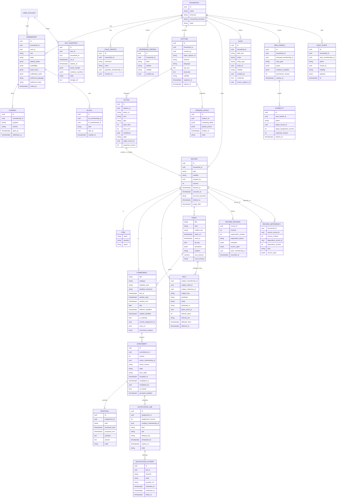
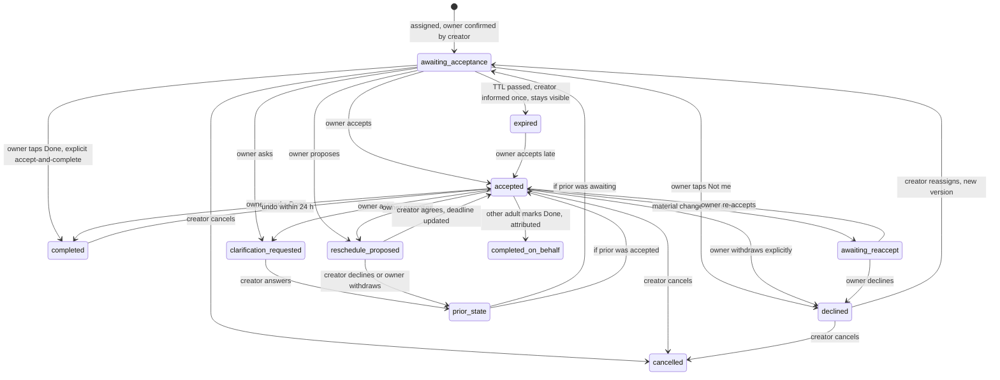
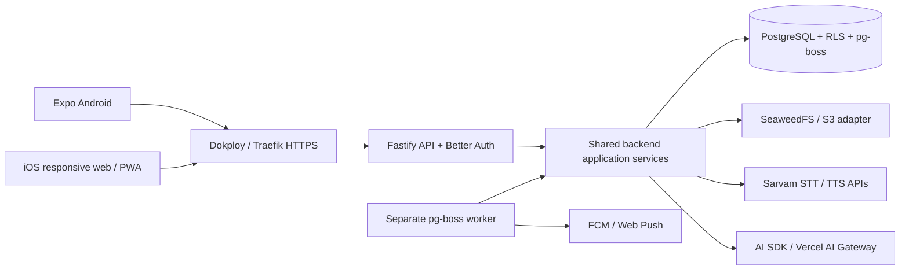

# Nilumi — Architecture

**Version:** 2.4 · **Date:** 11 October 2026 · **Status:** Baseline for Phase 1 build and pilot; production deployment decisions deferred.

[Product plan and vision](product-plan.md) · [Requirements and features](requirements-and-features.md) · [Architecture](architecture.md) · [Tech stack](tech-stack.md)

These four documents collectively form the Nilumi v2.4 baseline and supersede all earlier versions and notes. Original section numbers are retained for traceability.

The access, data, mutation, lifecycle, scheduling, surface and privacy contracts that implement the [requirements and features](requirements-and-features.md). Technology and processor choices are recorded in the [tech stack](tech-stack.md).

---

<a id="section-11"></a>

## 11. Phase 1 technical specification

Scope and user journeys are in [Requirements and features](requirements-and-features.md#section-11); the [date/time policy](requirements-and-features.md#section-11-7) supplies the temporal product defaults.

**Runtime decision:** one backend modular monolith in Node.js/TypeScript, exposed through Fastify with Better Auth and schema-generated OpenAPI; a separate pg-boss worker shares application services. Drizzle uses `pg` (node-postgres) to connect those services to one separate PostgreSQL database/service. Expo Android and the iOS web/PWA call the same backend. Deployment uses a Linux VM, Docker Compose and Dokploy; SeaweedFS provides S3-compatible file storage. See [§11.11–§11.15](architecture.md#section-11-11) for execution, retrieval, client/API contracts and database isolation.

<a id="section-11-4"></a>

### 11.4 Access matrix (normative)

Principal = authenticated user with an **active** membership (except A12 account-level exit rights). Workers (scheduler, pulse, export, view binder) re-check membership at execution; exit/retention work uses its explicitly bounded account/lifecycle rights, never a restored live membership.

| Action | Admin | Adult | Child / Reference person | Left / revoked (account-level) |
|---|---|---|---|---|
| Read `household` records, action-scoped sources, audit, views bound to them | ✔ | ✔ | — (no principal) | exit snapshot only (read-only, 90 days) |
| Read own `self` records | own | own | — | own, via account (90 days) |
| Edit own `self` records | own | own | — | ✖ |
| Forget / erase own `self` records | own | own | — | own, via checked account-level erasure (90 days) |
| Create record | ✔ | ✔ | — | ✖ |
| Edit / reschedule / cancel `household` record | ✔ (attributed) | ✔ (attributed) | — | ✖ |
| Share `self` → `household` | own | own | — | ✖ |
| Assign / reassign owner (active adult only; ≤ 3 reassignments per task) | ✔ | ✔ | — | ✖ |
| Accept / decline / propose / ask | if owner | if owner | — | ✖ |
| Complete | owner; others on-behalf (attributed) | same | — | ✖ |
| Status read (side-effect-free) | ✔ | ✔ | — | ✖ |
| Pause inbound from a member / mute / report | ✔ | ✔ | — | ✖ |
| Invite adult | ✔ | P2 | — | ✖ |
| Revoke adult / change role | ✔ (not self if sole) | ✖ | — | ✖ |
| Leave household | ✔ (successor or suspension) | ✔ | — | — |
| Manage child profiles | ✔ | ✔ if guardian | — | ✖ |
| Export household / accessible shared context / own-authored | ✔ (excl. others' `self`) | accessible shared + own | — | own `self` + read-only exit snapshot (90 days) |
| Delete household (7-day grace; both notified) | ✔ | ✖ | — | ✖ |
| Account recovery | own account only | own account only | — | own account only |

Rules: tenant-scoped FKs; write checks mirror read RLS; own `self` access resolves immutable creator-membership attribution to the authenticated account and requires an active membership or applicable account-owned exit window. **After exit, read/export/erase only for 90 days: no edits, new records, sharing or live household access.** Member switcher filters views only; view handles and capabilities are principal-scoped and expire; **missing and forbidden are indistinguishable** in responses; revoked sessions, cached actions and cached handles must fail in release tests. Database roles and context enforcement are specified in [§11.15](architecture.md#section-11-15).

<a id="section-11-5"></a>

### 11.5 Data model (authoritative records; Postgres + RLS)



**Contracts.**
- **Stable identity and revisions:** `RECORD.id` identifies the same logical record across confirmed corrections/changes; `revision` identifies its current snapshot. `(record_id, revision)` uniquely identifies a `RECORD_REVISION`, with `supersedes_revision` and confirmed `supersede_reason ∈ {correction, change}` for applicable edits. Current typed tables are projections of the same committed revision. History preserves attribution and effective intervals; snapshots are not permission to retain forgotten content indefinitely and participate in redaction/purge. Capabilities, citations and dependency edges bind exact revisions, never a silently substituted current value.
- **Responsibility state:** only `ASSIGNMENT.state` owns the handoff lifecycle. `COMMITMENT.current_assignment_id` selects its current assignment; the API's displayed commitment state is derived from it, not another independently writable field. Prior assignment versions are retained for audit, not current-work projections. Ownership changes and scheduling changes invalidate obsolete jobs/capabilities in the same transaction.
- **Deadline kind:** `deadline_kind ∈ {timed, window, all_day}` with exactly one valid shape (`due_at` | `window_start < window_end` | `day`); resolve the household timezone at confirmation and store it as `deadline_timezone` with the resolved UTC `effective_deadline`. Effective deadline = `due_at` | `window_end` | start of the next calendar day after `day` in that fixed timezone (exclusive all-day boundary). Reassignment, recipient travel and subsequent household timezone changes do not reinterpret a saved deadline; changing it requires a confirmed edit. `original_deadline` is immutable; `ASSIGNMENT.accepted_deadline` records what the owner accepted; extensions after a miss never create retrospective success.
- **Assignment versions:** owner change → new version (acceptance reset; old jobs cancelled). Material change (> 1 h, crossing a day, or window moved) → `awaiting_reaccept`. `prior_state` lets a rejected proposal restore the preceding responsibility state.
- **Temporal memory and dependencies:** `learned_at` immutable; `occurred_at` + `occurred_precision`; facts carry `effective_from/to`; `supersede_reason` recorded only after confirmation when ambiguous; revisions inherit the record's access contract. `RECORD_DEPENDENCY` records every factual/event basis with exact source/dependent revisions and action spans, replacing the single `basis_record_id` shortcut. Views, answer caches, aliases, jobs and export manifests also track their evidence/dependencies for invalidation.
- **Dependent corrections:** correcting a source immediately invalidates stale derived answers/displays and recomputes a task-change suggestion for authorized review. The task's confirmed fields, accepted deadline and valid reminder schedule stay unchanged until an authorized adult confirms that suggestion; display the pending correction separately. Existing task reminders bind the confirmed task revision/current assignment version; a basis correction alone does not obsolete that accepted schedule. Confirmation then uses the ordinary revision-checked reschedule service, cancelling/replanning obsolete jobs atomically and requiring owner re-acceptance for a material change. A suggestion is not a new assignment or an owner-proposed reschedule and never implies acceptance. Forget/revocation still suppresses unauthorized or forgotten content immediately.
- **Service seed (G9):** `EVENT.kind = service` with `subject_key` (provisional stable key created on first confirmed mention; never auto-merged by label), **canonical `cost_amount` + `cost_currency` on the event** (no separate cost fact); recommendation = `FACT` with `basis_event_id`, `attributed_to`, `interval_value`, `interval_unit`; P2 migrates `subject_key → ASSET` with user confirmation, **without retyping**.
- **Alias contract (C9):** aliases are confirmed household metadata or inherit the visibility of their source capture; `entity_type ∈ {membership, child, reference_person, asset(P2)}`; only `membership` entities are assignable; requester-relative kinship resolved per requester; collisions ("two Paatis") clarify; phonetic resemblance never authorises assignment or merge; alias edits attributed and reversible.
- **View handles and capabilities:** per principal, per permission version, ≤ 15 min; a `CAPABILITY` names action, exact target, assignment version, expected revision, expiry and carries an idempotency key; execution re-validates current state — stale → refresh + reconfirm, never silent retargeting.
- **Mixed captures:** `CAPTURE.visibility` governs the full source; each `ACTION` has its own span; shared records expose only their span.
- **Exit snapshot bundle:** freeze authorized household content/action-scoped provenance and its exact evidence manifest within the exit transaction before live access ends. `EXIT_SNAPSHOT.frozen_bundle` stages that account-owned content for background file serialization; `state` and `storage_ref` track serialization, not new access rights. The bundle, file and manifest remain subject to the 90-day maximum and dependency-linked forget/deletion suppression; workers never reconstruct the snapshot by scanning later live records.
- **Blocks:** `kind ∈ {pause_inbound, mute_task, report}`; reports are visible to support only.

P1 has no `SUBSCRIPTION`, payer, receipt, trial or payment-entitlement model. Backend feature availability and household usage controls apply to the free pilot independently of payments.

<a id="section-11-6"></a>

### 11.6 Mutation contract (normative field matrix; server-validated)

The model returns **proposals**; the server derives `household_id`, `actor`, `capture_id` from the authenticated request and ignores model-supplied identity. Unknown properties are rejected.

| Verb | Allowed types | Required fields | Optional fields | Server effect |
|---|---|---|---|---|
| `create` | item | `name` | `quantity` | insert after confirm card |
| `create` | commitment | `title`, `category`, exactly one of `due_raw` / `window_raw` / `day_raw`, `owner_label` **or** `needs_clarification:[owner]` | `linked_action_id`, `recurrence_raw`, `is_estimate` | insert + assignment v1 after confirm |
| `create` | event | `title`, `starts_raw` or `occurred_raw` | `kind`, `subject_key_hint`, `cost_amount`, `cost_currency`, `attendee_labels`, `location` | insert; `kind=service` applies the seed contract |
| `create` | fact | `subject_label`, `predicate`, `value` | `attributed_to`, `basis_action_id`, `interval_value`, `interval_unit`, `effective_from_raw` | insert; medical content → refusal receipt |
| `update` | item, commitment, event, fact | `target{query or id}`, changed fields | — | resolve to one editable record; `supersede_reason` **asked** if ambiguous |
| `correct` | fact, event, commitment | `target`, changed fields | — | as update with `supersede_reason = correction` (still shown on card) |
| `complete` | commitment | `target` | — | lifecycle action via registry (owner or on-behalf) |
| `cancel` | commitment, event | `target` | — | lifecycle action; creator/any adult, attributed |
| `ask` | fact, commitment, event | `question`, `subject_label` or `target` | `date_range` | **read-only**; never writes, shares or notifies; "ask a member" is a separate confirmed handoff |
| `status` | commitment | `target` | — | read-only `status_read` |

Common fields on every action: `action_id`, `confidence`, `source_span [start,end]` (must lie inside the capture), `visibility ∈ {household, self}`, `needs_clarification[]`. **`view_intent`** (one per response): `{ "view": "answer-card | grouped-list | timeline | clarify-form", "group_by": "owner | day | category | null", "filter": { "date_range": "today | this-week | next-7-days | this-month | custom", "status": "active | done | all" } }` — a hint only; it carries no data, handles or actions. Deletion is never a model verb. Each accepted action group and its outbox jobs commit in **one transaction**; uniqueness on `(household_id, client_capture_id, action_id)`. Forwarded content can never produce `update/correct/complete/cancel` on records it did not create, change visibility or permissions, invoke tools or fetch URLs. Adversarial fixtures (forwarded instructions, fabricated IDs, cross-household targets, hidden-fact probes) are in the release gate.

**Concurrency and replay:** commands against existing records supply an expected record revision and, for assignment actions, the current assignment version. Authorization and those preconditions are checked within the write transaction using conditional updates/appropriate locks. A stale precondition returns `409` with a refresh/reconfirm instruction and no mutation/jobs; missing and forbidden targets remain indistinguishable. Idempotency keys bind the authenticated actor and logical command payload: identical retries re-check current authorization before returning the committed result, while reuse for different content is rejected with `409`. Do not replay stored response content that is now inaccessible, forgotten or superseded; preserve the no-duplicate-effect guarantee while returning only an authorized receipt or a refresh/reconfirm response. Concurrent corrections, completion and reassignment cannot overwrite each other or issue side effects for a superseded version. API projections, evidence manifests and action capabilities expose the revision/version metadata required by clients; models do not supply authoritative versions. Error and transport conventions are in [§11.14](architecture.md#section-11-14).

**Action registry (single source for voice, chat, cards, notifications):** `item.tick` · `commitment.accept` · `commitment.decline` · `commitment.complete` · `commitment.complete_on_behalf` · `commitment.reschedule_propose` (owner) · `commitment.reschedule` (creator/any adult; triggers re-accept) · `commitment.cancel` · `commitment.ask` · `commitment.answer` · `commitment.reassign` · `reminder.snooze` (moves the next reminder only; never the deadline) · `fact.correct` · `fact.forget` · `status.read`.

<a id="section-11-8"></a>

### 11.8 Handoff lifecycle — transition table and diagram

**Transition table (normative; actor × state × action → next state).** "Creator" = originator or any active adult for shared records (attributed); "Owner" = current assignment owner.

| Current state | Owner may | Creator / adult may | Notes |
|---|---|---|---|
| `awaiting_acceptance` | accept → `accepted` · done → `completed` (accept-and-complete) · decline → `declined` · ask → `clarification_requested` · propose → `reschedule_proposed` (prior_state = awaiting) | reschedule → stays `awaiting_acceptance` (new deadline) · reassign → new version · cancel → `cancelled` | TTL: effective deadline + 24 h → `expired` (creator informed once; **item remains visible in Needs-my-response of the creator** until resolved) |
| `accepted` | done → `completed` · ask → `clarification_requested` (prior_state = accepted) · propose → `reschedule_proposed` (prior_state = accepted) · withdraw → `declined` (explicit) | material change → `awaiting_reaccept` · minor change → stays `accepted` · reassign → new version · cancel → `cancelled` · on-behalf done → `completed_on_behalf` | overdue flag when effective deadline passes (still `accepted`) |
| `clarification_requested` | — (waiting) | answer → restores `prior_state` · cancel → `cancelled` | question/answer stored on PROPOSAL (kind = question) |
| `reschedule_proposed` | withdraw proposal → restores `prior_state` | agree → `accepted` with new deadline (acceptance implied by the proposer) · decline proposal → restores `prior_state` (original deadline unchanged) · cancel → `cancelled` | the active deadline stays effective while a proposal is pending |
| `awaiting_reaccept` | re-accept → `accepted` · decline → `declined` · propose → `reschedule_proposed` | cancel → `cancelled` · reassign → new version | — |
| `declined` | — | reassign → new version `awaiting_acceptance` · cancel → `cancelled` · ask again (counts as **chasing**) | visible to creator until resolved |
| `completed` / `completed_on_behalf` | undo within 24 h → `accepted` (attributed) | undo within 24 h → `accepted` | late completion recorded as late |
| `expired` | accept late → `accepted` | reassign / cancel | never hidden from the creator's Needs-my-response |
| any open state | — | member exit/revocation: owner leaves → `awaiting_acceptance` **unassigned** flagged to creator; creator leaves → ownership of the record passes to the remaining adult | — |

**Snooze** (`reminder.snooze`) moves only the next reminder (≤ 3 times, ≤ 24 h total) and never the deadline. **Linked events:** rescheduling/correcting the event proposes the corresponding commitment change for confirmation first; confirming a material change requires owner re-acceptance. This source-derived suggestion is distinct from an owner proposal, where acceptance is implied by that owner's proposal. Cancelling the event cancels its linked commitment.



**Notification attempt (transport):** `queued → provider_submitted → delivery_confirmed (only where the channel reports device delivery) → acknowledged (observation only)`, with `failed → queued (retry while before expires_at) | expired`, `queued → cancelled` on obsolescence. Receipts render transport and responsibility states separately; *delivery unknown* when the channel cannot confirm.

<a id="section-11-9"></a>

### 11.9 Routing and scheduling rules (deterministic)

1. **Owner ladder (P1):** explicit active adult via confirmed alias → structured default-duty for the category → **clarify**. Reference persons, children, "us", unknown names and ex-members never become owners.
2. **Handoff notice:** at assignment, to the owner, by the owner's channel/quiet-hour preferences.
3. **Reminder schedule by state and deadline kind** (effective deadline *E*): `awaiting_acceptance` → nudge at *E* − 2 h ("still unaccepted") and at *E*; `accepted` timed → *E* − 2 h and *E*; `accepted` window → `window_start` and *E* − 30 min; `accepted` all-day → default 08:00 on `day` in the saved `deadline_timezone`, subject to recipient preferences/quiet hours; `awaiting_reaccept` / `reschedule_proposed` / `clarification_requested` → one notice at creation to the waiting party and one at *E* − 2 h; created within 2 h of *E* or past-due → one immediate notice only; `overdue` → nothing further to the owner (visible in Needs-my-response), one opt-in informational alert to the originator at *E* + 30 min.
4. **Quiet hours:** per recipient; deferred alerts **coalesce** into one at window end; the creator cannot override; near-deadline delivery inside quiet hours only if the recipient opted in; deferred past *E* → labelled "may be late".
5. **TTL:** reminders expire at *E* + 24 h; unaccepted handoffs → `expired` at *E* + 24 h (creator informed once; never hidden). On reconnection, expired reminders appear in Due now as history, not as current pushes.
6. **Volume cap:** ≤ 6 pushes/day per recipient; excess coalesces into pulse/review; quiet mode = digest only; per-originator open-handoff cap (E20).
7. **Dedupe key:** `assignment_id:version:kind:slot`; delivery at-least-once; client suppresses by key; invalidated on approved change or reopen.
8. **Rights re-check** at dispatch and at action execution (capability validation).
9. **Not supported:** emergency, safety-critical or time-guaranteed reminders — stated in onboarding and service terms.

<a id="section-11-10"></a>

### 11.10 Trusted generative surfaces (FD-1 with safeguards)

**Deterministic mandatory panels (P6).** `NeedsMyResponse` is a DB-computed projection on every request: pending `Confirm` proposals I created · handoffs where I am owner in `awaiting_acceptance` / `awaiting_reaccept` / `expired` · handoffs where I am creator in `clarification_requested` / `reschedule_proposed` / `declined` / `expired` · my `accepted` items that are overdue. `DueNow` = my accepted items with *E* within the next 24 h or overdue. Both are **complete, fresh, permission-filtered**, with "show all N" overflow, rendered in slots 1–2 **independent of any model output, cache or regeneration budget**, and recomputed on reconnect.

**Model-ordered optional cards (F1).** Below the mandatory panels, the model returns an ordered list of `{card, binding_query, title_hint, group_by}` from `{Today, SomeoneNeedsTo, Shopping, Upcoming, PeopleAndPreferences}`; the server validates names, bindings and actions, resolves data under the viewer's authorisation and renders. Invalid/partial output, timeout, cap exhaustion or outage → **fixed fallback order** `Today → SomeoneNeedsTo → Shopping → Upcoming → PeopleAndPreferences`. Layout cached per viewer + permission version + relevant revisions; **data inside cards is always current even when the layout is cached**; regeneration debounced ≥ 10 min, ≤ 4/day/viewer; pins override model order; empty/loading/error states defined; no generated URLs, code or action bindings.

**Result views (F4/F5).** Catalogue v1: `answer-card`, `grouped-list`, `timeline`, `clarify-form`. The model supplies **view intent only** ([§11.6](architecture.md#section-11-6)). The server issues a `VIEW_HANDLE` and `CAPABILITY` rows (exact target, version, revision, expiry, idempotency key); the client invokes capabilities, which call the registry's audited domain services. Q&A streaming shows content-free progressive states, then the complete validated answer/view after final authorization and evidence checks ([§11.14](architecture.md#section-11-14)); unsupported payloads fall back to text + fixed cards. **Existence safety:** private records never influence counts, labels, group order, `missing_context` text, follow-ups or handle errors (missing ≡ forbidden).

**Grounded answer contract (D11).**
```json
{ "answerability": "partial",
  "scope": "recorded service payments, car, 2026",
  "claims": [ { "text": "2 recorded service payments", "evidence_refs": ["rec_1", "rec_2"] },
              { "text": "totalling ₹3,200", "evidence_refs": ["rec_1", "rec_2"], "computed": "sum" } ],
  "missing_context": "Older visits may not be recorded.",
  "suggested_view": "timeline",
  "follow_up": { "text": "Add the earlier visits?", "requires_confirmation": true } }
```
`full` = every requested field present **within authorised recorded evidence**; `partial` otherwise; `unknown` → honest abstention and optional confirmed "ask <member>". Computations (sum, count, latest) are deterministic server-side with units over all authorized rows matching the stated scope, never a top-K evidence sample. Each opaque evidence ref maps server-side to an exact record revision/action span the viewer may read. Revalidate the evidence and permissions after synthesis and before serving the answer; a change invalidates/regenerates the affected claim or requires abstention. Conflicting facts are shown as attributed values; language uses "recorded" / "latest known".

**Experiments (F6; pre-registered before activation; directional with 20 households).**
- *E1 Feed:* household-randomised arms (10 model-ordered vs 10 fixed-order), blocked by baseline coordinator effort; primary endpoint **find-and-finish time** for the less-frequent adult on scheduled task opportunities (from app open, including generation time); guardrails: error rate, abandoned tasks, reported confusion; household-level analysis; dropouts retained.
- *E2 Views:* within-household, counterbalanced, paired tasks: generated view vs text-only answer for the same scenario (3–5 journeys); endpoints: resolution without further navigation, time, errors.
- **Decisions (decoupled, pre-declared):** *Feed ordering* defaults back to fixed precedence in Phase 2 if it misses a ≥ 15% median find-and-finish improvement, is inconclusive, or harms any guardrail — **regardless of E2**. *Result views remain* (FD-1); if model selection misses ≥ 85% appropriateness, a deterministic default selector with manual choice replaces it. **Immediate disable-and-investigate** on any unauthorised binding/action or hidden mandatory work, not a week-8 wait.

**Surface release gates (reproducible).** Reported with numerator, denominator and exclusions: (a) *adversarial suite* — seeded two-household mixed-visibility data, forged/expired handles, revoked member, role/assignment changes, stale capabilities, hidden-fact probes → **0 unauthorised bindings or actions**, and every injected fault falls back safely; (b) *user-impact fallback rate* on representative supported requests (incl. timeouts, cap exhaustion, cold cache) **< 5%**, injected faults excluded; (c) *view appropriateness* ≥ 85% on a 100-request labelled set with a fixed rubric, reported per language and view; (d) latency per [§12.1](requirements-and-features.md#section-12-1-slos).

<a id="section-11-11"></a>

### 11.11 Runtime, deployment and durable work



**Application boundary.** API route plugins adapt requests to shared domain/application services. Those services own authorization, state transitions, date interpretation, confirmation, evidence, free-pilot feature/usage policy and scheduling. The worker invokes the same services for asynchronous work. Clients render responses, collect input and manage bounded local UI/cache state; they never decide authoritative assignment status or grant household permissions. OpenAPI comes from the API's validated runtime schemas, and response validation prevents accidentally exposing unrestricted database objects.

**Database boundary.** One PostgreSQL database runs as a separate container/service with persistent storage, not an embedded database inside the API or worker. Drizzle with `pg` supplies typed access and reviewed migrations; enabled/forced native PostgreSQL RLS, mirrored write checks and tenant-scoped FKs enforce the access matrix. Separate `auth`, `app`, `pgboss` and `private` schemas and purpose-specific credentials isolate identity, product, queue and helper access. The internal transaction wrappers establish account/household/membership context without leaking it across pooled connections; runtime roles cannot own product tables or bypass RLS. See the normative [roles and transaction contract](architecture.md#section-11-15).

**Authentication and sessions.** Better Auth uses PostgreSQL-backed sessions through Drizzle. Disable server session-cookie caching and validate current sessions on protected requests; an Android/browser cached session is a presentation convenience, never evidence of current authorization. Check active membership/permission version separately for household routes, and applicable account-owned rights for recovery/exit routes. Revocation denies subsequent protected requests and invalidates capabilities/queued deliveries; recovery never restores a revoked membership. Trusted origins are explicit, and cookie-authenticated mutation routes require CSRF/origin protections without globally bypassing them for native integration.

Android uses `@better-auth/expo` and `expo-secure-store` for session cookies; authenticated application requests use the plugin's cookie accessor. Web/PWA uses Secure/HttpOnly session cookies over HTTPS. Credentials are excluded from SQLite/IndexedDB content snapshots, localStorage and content/query persistence; logout/account switch clears the local credential/session state and content caches. Native cached state does not waive backend validation. See [authentication configuration](tech-stack.md#section-12-2-runtime).

**Optional recovery email.** Offer verification of a personal recovery email through Resend at onboarding and settings; Skip remains available without restricting household activation. State that recovery may be unavailable without access to the registered number or a previously verified email. Recovery challenges bind the existing account and intended operation; an unverified/newly supplied email is not a recovery factor. Number changes follow A13's old-number or verified-email proof, new-number verification and 48-hour cooling-off policy. Successful recovery invalidates superseded sessions and revalidates current rights; notification to the other adult is content-free, not an approval that grants private access. Session expiry/refresh and OTP attempt/send limits are explicitly configured and tested before pilot admission.

**Transactional outbox.** Save each accepted action group, assignment/notification ledger changes and pg-boss jobs using `fromDrizzle(tx, sql)` on the same Drizzle transaction connection. A separate queue connection cannot make domain writes and enqueueing atomic. A rollback leaves neither a saved group nor its jobs. `NOTIFICATION_JOB` and `NOTIFICATION_ATTEMPT` remain the product's scheduling/receipt ledger; pg-boss owns queue execution state. Logical cancellation is committed in the product ledger; workers suppress obsolete jobs even if a physical queue entry remains. Job payloads contain bounded identifiers, versions and correlation IDs rather than copies of household transcripts.

**Worker execution.** Jobs include delayed reminders, long-audio transcription, pulse/review, exports and retention cleanup. Queue polling/supervision uses `nilumi_queue`; application handlers use `nilumi_worker` and a freshly validated actor/recipient context. Provision queue/schema changes during releases and disable runtime migrations, while retaining supervision and recovery. Configure per-queue concurrency, retry/backoff, execution expiration and heartbeat/recovery settings for the work's duration. Product expiry (*E* + 24 h for reminders) is independent of queue execution expiration. Worker restart recovers eligible durable jobs; handlers may execute more than once and must be idempotent. Before external side effects, reload current state and re-check membership or applicable account/lifecycle rights, visibility, assignment version, quiet hours, caps and expiry in a fresh transaction. Obsolete/revoked/expired work is cancelled or skipped with an honest ledger state. Provider submission cannot promise exactly-once delivery or device receipt.

Verify the chosen queue wake-up/polling and recovery configuration against the dispatch SLO; defaults are not evidence of meeting it. Exhausted retries leave a diagnosable failure and support re-drive only after current-state checks. Graceful shutdown stops fetching work and allows bounded in-flight completion. Queue depth/age, failed attempts and worker heartbeat are observable.

**Deployment and files.** Dokploy runs the application through Docker Compose and manages Traefik HTTPS routing. API, worker, PostgreSQL and SeaweedFS are separate services; application deployments preserve named data volumes. Store audio, exports and snapshots through the S3 adapter, with server-derived ownership, bounded presigned transfers and the retention contract. Validate CORS, expiry, deletion and export revocation behavior before real data; a signed URL alone is not proof of immediately revocable access.

**Recovery stages.** Disposable development/test data may be recreated without backup/disaster recovery. Durable queue recovery still operates after process restarts. Real household pilot data requires backups, a tested restore and suppression of deleted/forgotten content after restoration before admission. Production topology and final recovery objectives are deferred.

<a id="section-11-12"></a>

### 11.12 Retrieval and AI boundaries

**P1 retrieval pipeline:** authenticated principal → bounded validated query intent → authorized structured/alias/text queries → evidence and deterministic computations → grounded answer or abstention. The model never supplies executable SQL or authoritative identity/permission fields. `NeedsMyResponse`, `DueNow`, sums, counts, latest and assignment-state queries run directly against authoritative records.

**Bounded query grammar (C13):** subject/entity, record type, date/effective interval and status filters, with simple sum/count/latest or a paginated list. Query interpretation emits this validated intent, never executable SQL. Membership state and the access matrix are checked before resolution; only confirmed visible aliases may resolve identity, and ambiguous aliases require clarification. Typed relationships, dates and effective intervals take precedence over text rank.

**Text retrieval:** use PostgreSQL full-text search with `simple` and `pg_trgm`. Preserve original text and build retrieval text with Unicode NFC, whitespace normalization and Latin case folding; do not ASCII-strip, remove meaningful Tamil marks or joiners, or auto-transliterate identity labels. Permit a bounded validated set of alternative topic terms in English/Tamil/Tanglish (for example, milk / paal / பால்), applied only within the same authorized query scope. Topic expansion cannot add a confirmed alias, broaden identity/date/status filters, merge entities or authorize an assignment. The cross-script fixtures qualify recall; this is not a promise that lexical search understands every paraphrase.

**Evidence completeness:** compute sums/counts/latest from all authorized matching structured records with units/currency and stated scope. Paginate complete lists with stable record identity; any bounded text-evidence set is explicitly a subset and cannot be described as exhaustive. Search only eligible current/effective revisions for current questions; historical questions use the recorded effective intervals. Retracted corrections are not current evidence, changes retain attributed history, and unresolved conflicts show both values. Citation/permission checks also run after synthesis, including correction/forget/revoke races.

All candidate selection, grouping, counts, ranking and citations obey the requesting principal's current rights. Hidden records/private aliases cannot influence another viewer's outputs. Join authoritative tables for known relationships; no GraphRAG index or separate graph database is part of the initial runtime.

**Semantic-recall gate.** pgvector remains conditional P2 work: first diagnose a failed Tamil/Tanglish Q&A gate as missing semantic candidates rather than wrong filters, identity, stale data or answer synthesis. Compare a multilingual embedding path with the frozen lexical baseline on the same authorized evidence and held-out strata; require improved recall and the existing answer/citation/abstention gates with zero privacy regression before adoption. A P1 failure blocks release or narrows supported breadth under the existing product cut rule; it does not automatically admit a vector service. For small household datasets, begin with exact search over the authorized subset; do not assume that filtering a shared approximate index prevents hidden vectors from influencing recall. Embeddings are derived data and must participate in correction, forget, revocation and retention.

Retrieval references: [PostgreSQL text search](https://www.postgresql.org/docs/current/textsearch.html), [text-search dictionaries](https://www.postgresql.org/docs/current/textsearch-dictionaries.html), [`pg_trgm`](https://www.postgresql.org/docs/current/pgtrgm.html), [pgvector exact search and multitenancy](https://github.com/pgvector/pgvector).

**AI access.** API/worker services call AI SDK and Vercel AI Gateway with server-side credentials, versioned prompts/schemas, approved models/fallbacks and bounded time/cost. Models propose extraction, query intent and presentation; backend services validate and commit only authorized confirmed changes. Direct Sarvam adapters handle STT/TTS independently of the LLM gateway. Short audio uses the existing synchronous path; longer supported audio becomes durable worker work. Failed transcription offers retry or typed capture, not silent cross-provider fallback. Any recognition hints derived from aliases are limited to those the capture's principal may read.

Backend role configuration covers extraction, query interpretation, grounded answers and view suggestions. Initial qualification candidates are `google/gemini-3.5-flash-lite` for routine work and `google/gemini-3.8-flash` for harder cases; they are not yet release-qualified. Version approved model/provider routing, prompt/schema, token limits, total retry/timeout budget and usage accounting. Use Gateway provider `only` to enforce the vetted allowlist; provider `order` alone permits other fallbacks. Bound escalation (≤ 20% in the workload envelope), avoid multiplying retries across layers, and fall back to clarification/abstention/fixed views as applicable. Deterministic queries, state transitions and scheduling require no model call. Do not log routine prompts, transcripts or model outputs. See [LLM configuration](tech-stack.md#section-12-4-ui-ai).

The development/private-pilot permission for outside-India inference and the separate India-only production target are recorded in the [processor register](tech-stack.md#section-13-1-processors). An India-hosted speech API does not establish residency for transcripts subsequently sent to other AI processors.

<a id="section-11-13"></a>

### 11.13 Clients, synchronization and bounded offline operation

Expo/React Native supplies the installed Android application; Expo Router supplies navigation and responsive web/PWA entry points for iOS. Share contracts and presentation components where appropriate; platform-specific components cover browser accessibility/layouts and Android native integrations. Use Expo development builds for share targets, voice recording and native configuration. The iOS client is a PWA, not an embedded browser in a native wrapper. Native iOS remains P3.

**Custom UI:** Tamagui unstyled primitives sit beneath a Nilumi-owned UI package. [DESIGN-SYSTEM.md](DESIGN-SYSTEM.md) supplies Pastel Rooms tokens and the selected catalogue recipes, not older implemented button/checkbox geometry. Centralize text, button, field, task-tick, card, sheet and feedback components; preserve solid contextual surfaces, pill buttons, circular task ticks, Nunito/Noto Sans Tamil, Phosphor duotone treatment and authored motion timings. Bundle font/icon assets and implement script-aware text, system font scaling, native color fallbacks, focus/keyboard/screen-reader behavior, Android Back and reduced motion. Use real-device acceptance before expanding the library; the optional Tamagui compiler follows compatibility/correctness validation.

The design reference supplies visuals and interaction requirements, not new product scope. P1 badges reflect only `household`/`self` under the access matrix; the reference's read-only Shared tier is not added. Voice stays within B2's bounded capture rather than adopting continuous conversation. Mandatory work remains in deterministic panels regardless of optional reference navigation/feed patterns.

TanStack Query fetches/caches authorized backend responses through the shared `openapi-fetch` client and generated `openapi-typescript` types ([§11.14](architecture.md#section-11-14)). Query keys include account, household and permission context. Invalidate/refetch after successful mutations, reconnect, foregrounding and notification open; restart paginated lists from the first page and deduplicate by stable record identity. Active handoff screens can use bounded foreground polling for freshness. Fresh server projections remain mandatory for current work under §11.10. Notification delivery is not a synchronization guarantee. Full client database replication and CRDT infrastructure are outside the initial stack.

Persist only bounded pending drafts and authorized snapshots using Expo SQLite on Android and Dexie/IndexedDB on web. Scope storage and cache keys by account, household and relevant permission/revision versions; clear on logout/account switch and expire snapshots after 24 h. Do not persist sessions/tokens in these content caches. Browser storage is best-effort and may be evicted; pending-data persistence must not be represented as guaranteed. A remote revoke cannot erase already downloaded offline content, as disclosed in the product contract.

Replay pending commands with stable capture/action idempotency keys and expected revisions. Only a successful backend acknowledgment advances the receipt to Saved; stale versions, rejected rights or expired capabilities produce a visible refresh/reconfirm state. Refresh authoritative data and invalidate old handles on reconnect. Never silently retarget a replayed action or overwrite a newer server record.

Android push uses native FCM tokens. iOS PWA push uses standard Web Push, home-screen installation and user permission on supported devices; actions are tap-to-open. Device acceptance checks cover the existing supported-device matrix, WhatsApp text/audio sharing, killed-app delivery, disabled notifications, mixed-script accessibility and replay/conflict behavior. Browser automation does not replace actual iPhone push/install testing.

Client references: [Expo development builds](https://docs.expo.dev/workflow/overview/), [Expo Router](https://docs.expo.dev/router/introduction/), [TanStack Query in React Native](https://tanstack.com/query/latest/docs/framework/react/react-native), [Expo SQLite](https://docs.expo.dev/versions/latest/sdk/sqlite/), [Dexie storage](https://dexie.org/docs/StorageManager), [iOS home-screen Web Push](https://webkit.org/blog/13878/web-push-for-web-apps-on-ios-and-ipados/).

<a id="section-11-14"></a>

### 11.14 API and shared client contracts (normative)

**Transport and schema authority.** Application endpoints use REST/JSON under `/api/v1`; Better Auth retains `/api/auth` and its own SDK. Serve the PWA and API through the same HTTPS origin. Zod route schemas generate the OpenAPI document and validate requests, responses and model proposals. Generate `openapi-typescript` types from that document for a shared `openapi-fetch` client; TanStack Query domain hooks own application fetching/cache behavior. Generated types are compile-time checks, not runtime validators or authorization. Do not expose database models directly as response contracts.

**Authentication and compatibility.** Web requests use browser session cookies; Android reads the Better Auth Expo cookie accessor and attaches its cookie header with `credentials: "omit"`. Apply the existing trusted-origin/CSRF and current session/membership checks; the shared client does not grant authority from cached state. v1 changes must remain compatible with installed clients: add optional fields without removing behavior, and use a new API version for breaking changes. CI checks generated-type drift and incompatible schema changes; generated types must compile for Android and web.

**Error contract.** Application errors use `application/problem+json` with RFC 9457 `type`, `title`, `status` and safe `detail`, plus a stable Nilumi `code`, content-free `request_id` and optional field errors (`pointer` and stable `code`). The problem status matches the HTTP response. Clients localize presentation using codes; responses exclude request contents, stack traces, SQL and provider internals. Better Auth's SDK handles its own endpoint error format.

| HTTP status | Application meaning |
|---|---|
| 400 | Malformed request or invalid cursor encoding; no hidden-resource details |
| 422 | Invalid field values, including list limits outside 1–100 |
| 401 | Missing, expired or revoked session |
| 404 | Missing or inaccessible resource, household, capability or operation; indistinguishable response |
| 409 | Revision/assignment/state conflict or reuse of an idempotency key for a different payload; distinct stable codes, refresh/reconfirm for stale actions |
| 429 / 503 | Rate limit / temporary unavailability; `Retry-After` where applicable, within the operation's total retry budget |
| 500 | Unexpected application failure or response-validation failure; safe generic detail |

**Pagination and completeness.** Lists return `{ "items": [...], "next_cursor": "..." }`, with `next_cursor: null` when no further page is available at that read. Default limit is 20, maximum 100. Use opaque, tamper-resistant keyset cursors bound to the viewer, household, filters and ordering; each ordering includes a stable ID tie-breaker. Validate cursor scope and current access on every page without disclosing another viewer's resources. Lists are live rather than frozen snapshots: intervening changes may alter membership/order; refresh from the first page after mutations/reconnect and deduplicate by stable identity. Mandatory panels, their "show all N" counts and sums/counts/latest use complete authorized structured queries independently of the displayed page. A page or bounded evidence sample is never labelled exhaustive.

**Wire values and commands.** Instants are UTC RFC 3339 strings; calendar dates are `YYYY-MM-DD` strings, distinct from timestamps. Carry the confirmed IANA `deadline_timezone`; formatting in another locale must not reinterpret an all-day date or change the saved deadline. Money uses decimal strings plus currency, for example `{ "amount": "3200.00", "currency": "INR" }`; backend arithmetic remains exact and totals are separate per currency. Preserve original Tamil/Tanglish text during serialization. Commands retain stable idempotency keys and expected record revisions/assignment versions; replays re-check current authorization under §11.6. Stale commands refresh and require confirmation, and Saved/Scheduled receipts follow only the relevant backend acknowledgment.

**Q&A stream and cancellation.** Use fetch-based SSE (`text/event-stream`) with runtime-validated, typed `progress`, `result` and `error` events. `progress` contains content-free processing states; `result` contains the complete grounded answer and validated view only after the final current-permission, record-revision and citation checks. Never send raw model tokens, partial claims or unvalidated bindings. Before stream headers, failures use the HTTP problem contract; after headers, a terminal `error` carries a safe problem payload. A stream ending without a terminal `result` or `error` is incomplete, not success. Use `expo/fetch` on Android and browser fetch on web; `eventsource-parser` handles framing across split chunks, with bounded buffering and payload validation.

Leaving or backgrounding the question screen aborts unfinished read-only generation; propagate cancellation to backend/provider requests and prevent further retries or escalation. Provider cancellation is best effort and does not guarantee that billing stops. The client ignores late results for an abandoned request; reopening offers an explicit retry rather than automatically replaying generation. Submitted captures and confirmed commands are independent of this Q&A cancellation policy.

**Durable operations and caching.** Long-running work returns HTTP 202 with an opaque operation ID and authenticated status endpoint. Acceptance means processing, not a Saved/Scheduled receipt. Submitted captures and confirmed work continue through navigation and worker restarts; reading status re-checks current rights, revisions and deletion state before returning content. Foreground status polling backs off from two to ten seconds, stops on completion/failure or backgrounding, and refreshes on foreground/reconnect. Application responses use `Cache-Control: no-store`; browser/service-worker HTTP caches must not retain protected responses. Explicit TanStack/offline content storage remains governed by §11.13's account isolation, expiry and invalidation policy. No additional streaming, cache or synchronization service is required.

**Acceptance.** The [release checks](requirements-and-features.md#section-12-2) cover schema/type consistency on both clients; cookies, revocation and cache isolation; cursor/count/error existence safety; multilingual/date/money round trips; duplicate/stale commands; split SSE chunks and correction/forget/revoke during synthesis; cancellation without cancelling durable captures; and worker-restart survival. Selection of these interfaces does not establish passing results.

Contract references: [OpenAPI TypeScript](https://openapi-ts.dev/introduction), [openapi-fetch API](https://openapi-ts.dev/openapi-fetch/api), [Better Auth Expo requests](https://better-auth.com/docs/integrations/expo), [RFC 9457 Problem Details](https://www.rfc-editor.org/rfc/rfc9457.html), [Expo fetch streaming](https://docs.expo.dev/versions/latest/sdk/expo/#expofetch-api), [eventsource-parser](https://github.com/rexxars/eventsource-parser).

<a id="section-11-15"></a>

### 11.15 Database roles and transaction isolation (normative)

**Schemas and credentials.** Keep one PostgreSQL database. `auth` contains Better Auth tables; `app` contains product records, authorization metadata and account-owned snapshots; `pgboss` contains library-managed queue storage; `private` contains restricted helpers. Drizzle uses `pg` (node-postgres). Credentials are separated by purpose even when pools run in the same API/worker process; only release tooling receives migration credentials.

| Role | Access |
|---|---|
| `nilumi_owner` | Non-login owner of database objects; unavailable to application processes |
| `nilumi_migrator` | Release-only credentials for reviewed schema, policy and grant changes; privileged ownership access is confined to releases |
| `nilumi_api` | Product operations under RLS plus limited queue-producer permissions |
| `nilumi_auth` | Better Auth tables only; no household records |
| `nilumi_worker` | Authorized product operations under RLS and approved lifecycle procedures |
| `nilumi_queue` | Queue execution and supervision only; no product or authentication tables |
| `nilumi_acl_executor` | Non-login owner of narrowly scoped permission helpers, with explicit authorization-metadata grants/policies |
| `nilumi_lifecycle_executor` | Non-login owner of narrowly scoped retention/erasure procedures, with only their required grants/policies |

Runtime roles have no superuser, `BYPASSRLS`, role-creation, schema-creation or owner/executor-role membership. Non-login helper ownership is not runtime permission to assume those roles. Enable and force RLS on product tables, including authorization metadata, sources, typed projections, revisions, aliases, dependencies, ledgers, handles and account-owned snapshots. Missing context denies product access. Read and write policies mirror §11.4; row visibility alone never authorizes an owner-only transition. Runtime roles cannot truncate tables, alter policies or grant privileges.

**Permission and lifecycle helpers.** Avoid recursive membership policies by giving `nilumi_acl_executor` explicit read grants and narrowly assigned metadata policies; callers receive only necessary authorization results, not unrestricted membership rows. Restricted `SECURITY DEFINER` functions use fully qualified objects, a fixed search path limited to trusted schemas with `pg_temp` last, and selective execution grants. Revoke default `PUBLIC` execution when creating them, in the same migration transaction. Sensitive views use invoker permissions (`security_invoker = true`). Lifecycle procedures validate operation/target, current erasure rights or database-time expiry/tombstone state, and return only necessary identifiers/status. They remain usable for required retention after membership ends without granting a general content-read interface, arbitrary SQL execution or direct assumption of the executor role.

**Transaction interface.** Internal `withHouseholdTx`, `withAccountExitTx` and `withJobTx` wrappers establish the applicable account, household, membership and access mode. HTTP identity comes from current Better Auth validation followed by account-to-membership mapping, not request-body actor fields. Jobs reload their actor/recipient or account-owned grant under current rights; a job ID is not authority, and retained durable work does not depend on replaying an old browser session. Use parameterized `set_config(..., true)` within the transaction; context is transaction-local and is never set for the connection's whole session. Repositories receive that Drizzle transaction and all statements use its same connection, including enqueueing. No global database handle or pool query may silently escape the context.

Use short `READ COMMITTED` transactions with the existing expected revisions, assignment versions and conditional updates/row locks. Acquire a shared transaction advisory lock for ordinary household operations and an exclusive transaction advisory lock for membership/permission changes, visibility changes and forgetting. Resolve the lock key consistently from the household identity, acquire the strongest required mode initially, and use a consistent lock order before record locks. Commit/rollback releases both context and locks. Keep LLM, speech, file/storage and notification network calls outside transactions; perform final rights/revision/evidence checks in a fresh transaction before returning generated content or dispatching work. Revocation applies to subsequent access; already delivered content is not retrospectively recallable.

**Pools and queue grants.** Start with bounded native `pg` pools and no PgBouncer. Budget total connections across API product access, Better Auth, worker product access, queue execution, any dedicated listener and operational headroom. `nilumi_api` and domain transactions receive only the queue-producer grants required for enqueueing/metadata reads, not claiming or queue administration. Use `fromDrizzle(tx, sql)` so domain changes, notification ledger changes and job creation commit or roll back together. Logical cancellations are product-ledger changes in that transaction; handlers suppress cancelled/obsolete entries before effects. `nilumi_queue` polls/maintains queue state and `nilumi_worker` runs subject-scoped domain services. Do not use queue credentials to access product tables.

Provision queue definitions/schema changes through reviewed release steps; application and queue runtime instances use `migrate: false` and cannot perform DDL. Retain queue supervision/recovery. Initially use shared queue storage without dynamically created partitions or persisted statistics requiring runtime DDL; producer instances do not run worker supervision. Required queue migration or grant mismatch fails readiness rather than expanding runtime privileges. Verify the exact grants against the pinned library version and restricted-role startup/enqueue/claim tests.

**Attribution, exit and retention.** Tenant-scoped foreign keys prevent cross-household links; referenced targets are validated under current rights before writes, and constraint errors follow the safe API contract. Household identity and creator attribution are immutable. Typed children/history inherit the parent access contract; dependency reads do not expose an inaccessible endpoint. Account-exit mode allows read/export of the account's own private records and its frozen exit snapshot for 90 days, with erasure through a checked procedure only. Ordinary editing, creation, sharing and live household access remain denied.

Freeze authorized snapshot content and its evidence manifest inside the exit transaction before live access ends, using the `EXIT_SNAPSHOT` staging bundle rather than an external storage call. Background jobs serialize that frozen account-owned bundle; they must not scan later live records or restore membership to assemble it. Bundle/file/manifest accesses re-check expiry and forget/deletion suppression, exclude other adults' private content/full private sources, and retain the existing account-owned download contract. Retention functions verify database time, target scope and expiry/tombstone state, and must continue after departure while applying redaction/purge to staging bundles, files and dependent artifacts.

**Trust boundary and acceptance.** The trusted backend establishes identity; RLS adds protection against incorrectly scoped queries and does not make a compromised backend trustworthy. The [database acceptance suite](requirements-and-features.md#section-12-2) exercises actual runtime credentials, schema/role isolation, missing context, pooled-connection reuse, concurrent permission/data changes, record/job rollback, exit-time snapshots, post-exit erasure/retention and restricted startup. These are implementation requirements, not passing results or a provisioned database.

Database references: [PostgreSQL row security](https://www.postgresql.org/docs/current/ddl-rowsecurity.html), [safe function ownership](https://www.postgresql.org/docs/current/sql-createfunction.html), [invoker views](https://www.postgresql.org/docs/current/sql-createview.html), [transaction-local settings](https://www.postgresql.org/docs/current/functions-admin.html), [transaction/advisory locks](https://www.postgresql.org/docs/current/explicit-locking.html), [node-postgres transactions](https://node-postgres.com/features/transactions), [Drizzle PostgreSQL drivers](https://orm.drizzle.team/docs/get-started-postgresql), [pg-boss adapters](https://pgboss.io/api/adapters), [pg-boss installation](https://pgboss.io/install), [pg-boss runtime configuration](https://pgboss.io/api/constructor).

---

<a id="section-13"></a>

## 13. Privacy, security and compliance

<a id="section-13-1"></a>

### 13.1 Provenance, retention, children, notifications and export

**Provenance scoping and existence safety.** Records expose only their action span; mixed captures keep full source creator-private; audit payloads, exports, aliases and derived context inherit visibility; pulse/review shared lines and counts come only from `household` records; caches keyed by viewer + permission version + revisions. **Paired-world release test:** adding/editing a hidden fact or private alias must not change another adult's answer, count, label, group order, follow-up, missing-context text or handle error; extended through correction and forget chains.

**Retention and deletion matrix (maximums).**

| Data | Retention | Deletion reach |
|---|---|---|
| Pending/unconfirmed capture; pending intent | 24 h | — |
| Raw audio | Deleted on confirmed transcription; 24 h hard expiry; signed URLs ≤ 15 min | Storage + provider logs per register |
| Transcript / source text | Life of derived records; private if mixed; **forgotten/private spans redacted while surviving shared records keep only their own span** | Hard purge with the last dependent record |
| Records (deleted / forgotten) | Hard purge 30 days after delete; forget removes from answers, search, pulse, views, suggested questions, aliases and exports immediately; re-extraction from retained sources must not resurrect | Indexes, caches, queued jobs, derived cards, aliases |
| View handles / capabilities | ≤ 15 min; invalidated on permission change | — |
| Exit snapshots | 90 days; content/manifest frozen before live access ends; account-owned read/export only | Staging bundle, file and manifest; forget/deletion suppression still applies |
| Audit events | 180 days; payload redacted on purge | — |
| Notification jobs/attempts | 90 days | Cancelled on revoke/delete |
| Export files | Authenticated download available for at most 7 days; manifest/access rechecked on every request; invalidated on forget of included records | Storage object + manifest + download grant; downloaded copies cannot be recalled (disclosed) |
| Backups | Real household pilot/production data: 30-day rolling; tested restore must not resurrect; disposable development/test data may have no backups | Purged by rotation |
| Telemetry | Reliability telemetry (no content) 180 days; optional research analytics per its consent | — |
| Vendor processing logs | Per processor register | Contract terms |

**Export contract (A7, A12):** versioned UTF-8 JSON preserving IDs, relations, revisions, visibility, date precision, attribution, units and currency; Markdown as readable companion; admin export excludes others' `self`; adults export accessible shared context plus own-authored; exit snapshots use the same schema.

**Forget propagation:** tombstone the record immediately and invalidate dependency-linked search entries, aliases, answer/view caches, capabilities, queued work and export manifests. Remove forgotten spans from retained capture text so later extraction cannot recreate them. Track exact source revisions/spans across derived records and artifacts, including composite answers. Redact or suppress derived content that repeats forgotten material; cancel derived deliveries rather than retaining their copied content in payloads. Surviving independent shared records retain only their own authorized spans. Re-check dependencies before serving an artifact or performing a queued side effect. Historical snapshots/audit payloads participate in the existing redaction and purge policy; restore applies deletion suppression before exposing restored data.

**Revocable downloads:** exports have an evidence manifest of included IDs/revisions and an authenticated backend download route. Validate account/live-membership or applicable account-owned exit rights, manifest expiry and current deletion/forget state on every request; stream the private object after that check. A revoked live membership does not retain a live-export grant; A12 exit snapshots have their separate account-owned scope and lifetime, subject to deletion suppression. Do not expose a seven-day raw S3 presigned download URL as the export grant. Once a copy is downloaded, it cannot be recalled; an in-flight response is also not retroactively retractable. Audio retains its separate bounded-transfer contract.

The [processor/data-flow register](tech-stack.md#section-13-1-processors) specifies provider, location, retention and fallback constraints.


**Child-data pathway (A10)** as catalogued; legal review determines permitted fields and verification timing; no phase-based exemption.

**Health/sensitive exclusion (I6)** — best-effort refusal at capture with receipt; disclosed limitation; no medical facts, instructions or "doctor said" content stored in P1.

**Notification privacy (I7)** — generic preview default; rich preview opt-in; opaque action IDs; consequential actions require unlock.

**Breach runbook (I8)** — detect → contain → initial notice to affected members and the Board *without delay* → fuller information within 72 h → review; tested before dogfood.
