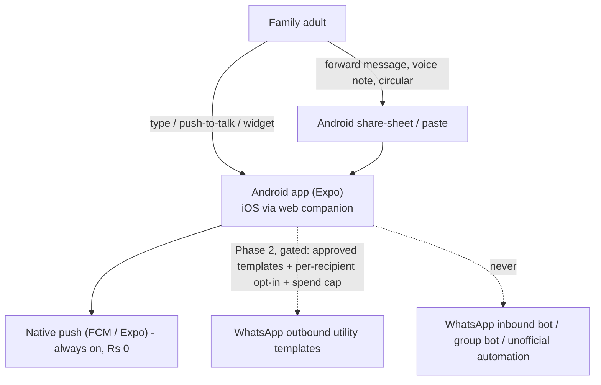
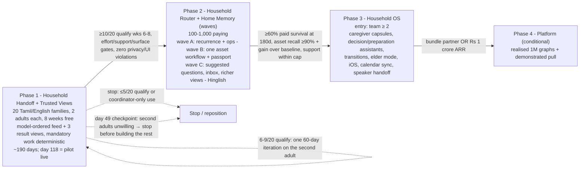

# Nilumi — Product Plan and Vision
## The household's trusted memory and follow-through layer — for Indian families

[Product plan and vision](product-plan.md) · [Requirements and features](requirements-and-features.md) · [Architecture](architecture.md) · [Tech stack](tech-stack.md)

> **One-line definition.** Nilumi is the household's trusted, living memory and follow-through layer. Any adult speaks or forwards something once — in English or Tamil/Tanglish — and Nilumi shows exactly what it understood, remembers it with evidence, presents the right interactive view for the question, and **helps one named adult accept it, be reminded, and close it, with unaccepted or unfinished work always visible** — without the coordinating parent chasing and without turning family life into project management.

---

## 1. Document control and how to read this plan

| Field | Value |
|---|---|
| Product | Nilumi — shared household assistant for Indian families |
| Document | Product plan and vision (strategy, roadmap, pilot, business model and governance); requirements, architecture and tech stack are companion documents |
| Version | 2.4 — four-document baseline |
| Date | 11 October 2026 |
| Status | Baseline for Phase 1 build and pilot |
| Owner | Founder (solo technical founder) |
| Founder constraint | Solo, nights-and-weekends (~10–15 hrs/week), bootstrapped |
| Source of truth | **These four documents collectively.** The Nilumi v2.4 baseline is self-contained across the product plan, requirements and features, architecture and tech stack, and supersedes all earlier versions and notes. |

**Evidence labels used throughout.** **Fact** = publicly documented and checked at the date above · **ESTIMATE** = calculated or assumed number, to be validated · **JUDGEMENT** = reasoned product/strategy call · **Hypothesis** = a belief the pilot or a later phase must test · **Bounded finding** = true for what was reviewed, not proof of absence. Competitor capabilities are the vendors' public descriptions, not independent proof of quality.

**Tags used in requirement tables.** **P1** = must ship for the Phase 1 pilot · **P2 / P3 / P4** = later phases (Phase 2 is split into waves A, B, C) · **Deferred** = requires a later scope review before implementation · **Never** = out of scope · **Test** = which admission criteria (1–6, [§5.3](product-plan.md#section-5-3)) a feature meets, or **infra** for identity, consent, privacy, legal and operational hygiene that is exempt (billing is deferred) · **DF1–DF6 / X1–X12** = flagship differentiators and exploration items ([§5.2](product-plan.md#section-5-2)) · **FD-1…FD-3** = key founder decisions ([§20](product-plan.md#section-20)) · **UJ0–UJ9** = Phase 1 user journeys ([§11.3](requirements-and-features.md#section-11-3)).

**Document map.**

| Document | Sections and contents |
|---|---|
| [Product plan and vision](product-plan.md) | 1 Document control · 2 Executive summary · 3 Problem · 4 Market and competition · 5 Vision, thesis and strategy · 6 Target users · 7 Positioning · 8 Product principles · 9/9.1 Roadmap and phases · 14 Success metrics and pilot plan · 15 Later phases · 16.1 Pricing and unit economics · 17 Go-to-market · 18.1 Operations and capacity · 19 Risks · 20 Key decisions and trade-offs · 21 Open questions · 22 Glossary |
| [Requirements and features](requirements-and-features.md) | 9.2 Signature demonstrations · 10 Feature requirements catalogue · 11.0–11.3 Phase 1 MVP scope and journeys · 11.7 Date/time policy · 12 Device spike, SLOs, evaluation and quality · 13.2 Compliance checklist · 16.1 Budget-limit behavior · 16.2 Free-pilot feature policy · 18.2 Pilot service terms |
| [Architecture](architecture.md) | 11.4–11.6 Access matrix, data model and mutation contract · 11.8–11.10 Lifecycle, scheduler and trusted surfaces · 11.11–11.15 Runtime, retrieval, client/API contracts and database isolation · 13.1 Provenance, retention, privacy, security and export |
| [Tech stack](tech-stack.md) | 12.1 Chosen stack · 12.2–12.4 Execution, deployment and observability · 12.5 Remaining review order · 13.1 Processor/data-flow register |

The visual specification is [DESIGN-SYSTEM.md](DESIGN-SYSTEM.md), Pastel Rooms v1. Nilumi v2 adopts its catalogue recipes beneath a Tamagui-based custom component library; product scope and permissions remain governed by these core documents.

---

## 2. Executive summary

**What Nilumi is.** A phone-native household assistant for Indian families that turns anything one adult says or forwards — in English or Tamil/Tanglish — into confirmed, evidence-backed household memory and into commitments that **one named adult accepts, is reminded about and closes**, without the coordinating parent having to chase.

**The problem.** In most Indian homes one adult — usually the mother — carries the household's anticipation and monitoring work. Indian women spend 289 min/day on unpaid domestic work vs 88 min for men (Time Use Survey 2024). Information is scattered across WhatsApp, speech, notes and reminders; coordination happens by forwarding and chasing. Shared lists and calendars share *data*, not *responsibility*: Apple and Google document that shared reminders and family calendars do not notify the other member.

**The opportunity.** Capture, shared lists and household memory are now commodity and largely free (Google Keep, Apple Reminders, WhatsApp events, Meta AI, Alexa+ in India). What is unsolved — especially on a phone, without hardware, in Indian languages — is **closed-loop transfer of responsibility** between adults, combined with **correctable, permission-safe household memory** and **India-specific recurring workflows** (school, domestic help, elders, services). Nilumi competes on the dependable *combination* and execution of these, not on any single feature.

**How we win (strategy).**
- Android-first app with native push; WhatsApp used only as **share-sheet ingress** (forwarded messages, voice notes, circulars) — never as the primary interface.
- English + Tamil/Tanglish first (founder access), Hinglish in Phase 2.
- One named owner per commitment; acceptance, reminders by the recipient's preferences, visible until closed; trust receipts for every action.
- Evidence-or-abstain answers with citations; deterministic, complete "needs my response" work; model-chosen views only from a trusted catalogue, bound server-side.
- Private by construction (database-enforced visibility); no humans in the loop, no hardware, no payments, no health content in Phase 1.
- **Development and the real eight-week pilot are free.** Charging, pricing and willingness-to-pay validation are deferred; run as a micro-SaaS that may become acquirable.

**Phase 1 — the bet we test first.** A free, eight-week, 20-family pilot (two consenting adults each; Chennai, Coimbatore, Bengaluru). ≈ 190-day plan: research, build and release gate to day 91, recruitment to day 105, two-week baseline diary, **pilot live ≈ day 118**, product weeks 1–8 free, **decision ≈ day 190** after measurement and exit interviews. ≈ 280 founder hours (peak ≈ 14 h/week), cash ceiling ₹1.5 lakh.

**Phase 1 continue gate.** ≥ 10 of 20 enrolled families have ≥ 3 unchased, accepted-and-completed handoffs from the coordinator to the second adult in **each** of product weeks 6–8 · coordinator effort does not rise · support ≤ 3 founder h/week and falling · zero privacy violations · zero unauthorised view bindings/actions · surface gates met. Stop at ≤ 5/20 or coordinator-only use; iterate once at 6–9/20. Payment and renewal are not pilot gates.

**Economics (ESTIMATE, future charging scenarios).** The prior ₹299 price and contribution calculations in [§16.1](product-plan.md#section-16-1) are unvalidated later-phase hypotheses, not pilot offers or measured revenue. The free pilot measures adoption, support effort and actual API/SMS costs; fixed infrastructure targets ₹3,000–₹5,000/month, excluding AI and SMS. Commercial viability still requires a later charging experiment.

**Roadmap.** Phase 1 Household Handoff + Trusted Views (20 families) → Phase 2 Household Router + Home Memory (100–1,000 paying, in waves: recurrence and Hinglish; one asset workflow and passport; richer memory and views) → Phase 3 Household OS (team ≥ 2; caregiver capsules, elder mode, iOS, calendar sync) → Phase 4 consent-based household-context platform (conditional).

**Top risks.** The second adult does not engage · free tools are "good enough" · Tanglish extraction and date errors break trust · generated UI hides work or leaks private existence · solo-founder support capacity · Meta platform discretion · thin economics.

**Classification.** A **product** — not a feature, and not (yet) a platform ([§5.4](product-plan.md#section-5-4)).

---

## 3. Problem

### 3.1 The household mental load and the "default parent"

The pattern the founder observed — one adult is the keeper of household knowledge, information is scattered across WhatsApp, speech, notes and reminders, and coordination happens by forwarding — is measured and structural, not anecdotal.

**India (Fact).**
- Time Use Survey 2024: women spend **289 min/day** on unpaid domestic services vs **88 min** for men (3.3×); caregiving 137 vs 75 min. The gap barely moved since 2019 (299 vs 97). Employed women additionally work 341 min/day.
- PLFS 2025: **44.4%** of women outside the labour force cite child-care/home-making as the reason. Urban female labour-force participation is only **28%** (2023-24) but rising (+2.6 pp year on year) — dual-income coordination is a growing problem.
- NFHS-5: 89% of married women participate in household decisions while ~31% had paid work in the prior year — the *decision* burden is high even where income is not.
- Nuclearisation: average household size 4.8 (Census 2011) → 4.4 (NFHS-5); yet **~68% of Indians aged 60+ co-reside with their children** (LASI), so "nuclear" households routinely carry an elder's appointment and refill logistics.
- There is **no large-sample Indian survey quantifying mental load** — an evidence gap the pilot partly addresses.

**Global comparators (Fact).** 64% of mothers in US two-parent homes do more of the children's schedule management, even in dual-full-time couples (Pew, 2015). 86% of working mothers handle the majority of family responsibilities (Modern Family Index, 2017). Cognitive household labour = **anticipate → identify options → decide → monitor**; women perform most anticipation and monitoring even in egalitarian-identifying couples (Daminger, 2019).

### 3.2 The unsolved gap: shared data is not shared accountability

- Apple Reminders shares lists but "reminder notifications someone sets are not shared automatically"; Google Keep reminders stay individual; Google Calendar's family calendar sends no default notification when another member creates or edits an event (vendor help pages; Fact).
- Alexa+ can route a reminder to a person only with Visual-ID hardware (Fact).
- **Design implication (JUDGEMENT):** the value is in **redistributing anticipation and monitoring** across adults — route, obtain acceptance, follow up and close — not merely store. A design that makes the keeper the sole data-entry clerk for a smarter list fails before it ships. *A reminder without acceptance is not delegation; acceptance without completion is not closure.*
- **Strongest counter-argument (JUDGEMENT):** reluctance to share responsibility may be *relational*, not informational. If a partner ignores a spouse, a polite notification may change nothing. The pilot must detect this early rather than promise to repair it.

### 3.3 India-specific recurring jobs

| Job | Evidence (Fact unless marked) | Example interaction | Boundary |
|---|---|---|---|
| School and tuition handoffs | WhatsApp is the primary school–parent channel; fees are term-wise; ~31% of urban students take tuition | Forwarded circular → dated commitment for the school-prep parent | No scraping of school groups; no invented instructions |
| Recurring service follow-ups | Society apps handle the society side, not the household action | "Plumber Saturday; Karthik will be home" → dated prep task | Do not rebuild society apps |
| Domestic-help coordination | ~28 M registered domestic workers; ESTIMATE 25–40% of top-metro households employ help | "Cook won't come tomorrow" → adjust plan, remind whoever is home | No payroll, attendance surveillance or payments |
| Co-resident elders | ~68% of 60+ co-reside; ~24% have multimorbidity | Quarterly check-up; refill *pickup* routed to whoever is free | No dosing/adherence/medical advice |
| Tiffin and meal logistics | Preference memory the cook's instructions depend on | "Paati doesn't eat spicy"; who packs tomorrow's tiffin | Not a recipe generator |
| Quick-commerce lists | Quick commerce is the leading urban shopping shift (Blinkit ~27 M monthly transacting customers) | "Paal mudinjiduchu" → shared list; copy to a quick-commerce app | No cart APIs or autonomous buying in early phases |
| Festivals | Engagement peaks at Deepavali, Pongal, Navaratri | Short-lived festival collection | Seasonal alone cannot sustain monthly retention |
| Home assets and services | Appliances, vehicles, warranties, service visits recur for years | "Purifier serviced today, ₹1,800; filter in six months" | No budgeting, ledger or equipment-health inference |

**Why India favours this product (Fact):** nuclearisation; the unpaid-work gap; rising urban female participation; 44% of Indian internet users already use AI features; Indian in-app purchase revenue exceeded $1 bn in 2025 and grows ~33–35% a year.
**Why India is harder (Fact):** premium AI is being given away (Gemini Pro via Jio, Perplexity Pro via Airtel, ChatGPT Go free for a year, Alexa+ with Prime); per-download revenue is tiny, so pricing must be per household; UPI AutoPay sees ~20 M mandate revocations/month (74% for insufficient funds); Alexa+ now owns the Hinglish-voice narrative.

---

## 4. Market and competition

### 4.1 Named competitors (vendors' public descriptions; checked 11 Oct 2026)

| Product | What it offers | Price | India | Lesson for Nilumi |
|---|---|---|---|---|
| **Nori** | Family AI: voice, chat, photos, forwarded email; persistent family preferences and routines; assigned chores and reminders; proactive notice → suggest → confirm → act; optional hub (US/CA). Claims 200,000+ families | Free core; US$7.99/mo; **₹799/mo** in India | Listed; negligible Indian uptake; no Indian languages | A household-priced family-AI category exists — but English-only, US workflows, priced 2–4× above Indian tolerance |
| **Home Run** | Voice/chat, cross-domain family plans, chore assignments and follow-up, documents, meals, expenses, shared family context | Paid | Not India-focused | "Connected plans across tasks, documents and calendars" is not uniquely ours |
| **Ohai** | Household manager by text/voice/email/docs; **human assistants** for complex documents; shared circles; "assign tasks and Ohai texts the right person"; calendar sync. ~36 employees, ~US$6 M+ funding | US$9.99–39.99/mo | Not available | Routing to the right person sells in the US — delivered with a team and humans in the loop |
| **Pratyek** | India-focused WhatsApp household assistant + shared "Memory" dashboard; maid attendance/salary, milk, warranties, school fees; 9 languages + Hinglish; cannot join existing family groups | Paid; amount, traction and reliability unverified | Yes | Indian-language household records and Q&A are not uniquely ours; WhatsApp dependency is a policy exposure |
| **Alexa+** | Generative Alexa; **India Early Access since 16 Sep 2026** with English, Hindi, Hinglish code-switching; household memory; person-targeted reminders need Visual-ID hardware; contextual "Dynamic Tab" on tablets | Free in Early Access, then with Prime; ₹2,000/mo standalone | **Yes** | Hinglish household memory ships free inside Prime — but device- and ecosystem-bound |
| **Gemini for Home** | Replaces Google Assistant on Nest; explicit "Saved information"; shared family calendar/lists | Free; US Premium US$10/20 | **Not in India** | Household memory is table stakes for Big Tech voice; Google's India absence is a window (JUDGEMENT: 12–18 months) |
| **Milo** (closed 12 Jan 2026) | SMS + humans-in-the-loop "Family AI"; US$15 → US$40/mo | — | No | Families paid for the useful core; reliability collapsed when scope widened. Scope discipline + reliability is the whole game |

### 4.2 Wider landscape

| Group | Products and evidence (Fact) |
|---|---|
| Family organisers | Cozi, FamilyWall, TimeTree, Jam, Hearth, Skylight, chore apps, AnyList/Bring!/Out of Milk. Tab-based; the user picks the list; routing weak; no Indic languages. Prices in India from ₹269/mo to ₹3,999/yr |
| Big-tech "good enough" | Apple Reminders and Google Keep/Calendar share data but not reminders/notifications; WhatsApp itself has group events with reminders, @all, polls — free, human-triggered |
| General AI with memory | ChatGPT Shared Projects (project-only shared context, no household routing); Claude projects; Gemini Personal Intelligence (single-user, India since Apr 2026); **Meta AI in WhatsApp** — free in groups, Hindi/Romanised Hindi, memory 1:1 only, proactive tasks "forthcoming" for WhatsApp |
| India-specific | Pratyek; Grihini (staff salary/attendance; Hindi/English voice); Ghar Kharcha (shared khata); MyGate (4 M+ households) and NoBrokerHood (society operations); quick-commerce apps (100 M+ installs each) without shared family lists |
| Graveyard | **Yohana** (US$249/mo human concierge) ended US Sep 2025, Japan Jan 2026 — had not demonstrated scaling and monetisation · **Milo** closed Jan 2026 on reliability · **Maple** announced sunset on 31 Dec 2026 **with all data deleted** — the continuity fear families have about small apps · Picniic/OurHome delisted |

### 4.3 Comparison matrix

| Product | Interaction | Shared memory | Routes to a member with acceptance | Dynamic UI | Price | India | Biggest weakness |
|---|---|---|---|---|---|---|---|
| Nori | Chat/voice/photos; hub | Explicit family prefs | Assigned reminders; suggest → confirm → act | Fixed views | ₹799/mo | Listed; no Indic | Price; US workflows |
| Ohai | SMS, voice, email + humans | Shared circles | **Yes** (texts the right person) | Fixed tabs | US$9.99–39.99 | No | Human cost; US-only |
| Alexa+ | Echo voice, app | Household facts + per-person ID | Hardware-dependent | Dynamic Tab | Free w/ Prime | **Yes, Hinglish** | Device-bound |
| Gemini for Home | Nest voice, Home app | Saved information | Unverified | NL automations | Free / Premium | No | Not in India |
| Pratyek | WhatsApp + dashboard | Claimed shared records | Claimed | Records | Unverified | Yes | Unverified; policy exposure |
| Cozi / FamilyWall / TimeTree | Tabbed apps | Shared records | Weak | None | ₹269–3,999 | Yes | User does the organising |
| Apple / Google native | Native apps | Shared data | **No** | None | Free | Yes | No routing |
| Meta AI in WhatsApp | @ in groups | No group memory | No | None | Free | Yes | No shared state |
| **Nilumi (target)** | Phone voice/text + share-sheet | Evidence-backed, correctable, permission-safe | **Yes — one owner, acceptance, closure, receipts** | Trusted catalogue views bound server-side | ₹299/mo | **Tamil/Tanglish + English; Hinglish P2** | Must prove second-adult adoption |

### 4.4 What the landscape means

1. **Every constituent feature already exists somewhere** — memory, extraction from messy input, targeted reminders. The opportunity is the **combination working dependably with less supervision**, in India, on a phone.
2. **Shared data ≠ shared accountability** — the one gap the incumbents document against themselves.
3. **Breadth with humans in the loop died or reset** (Milo, Yohana); narrow, software-only products survive.
4. **Reliability complaints are universal** (lost lists, wrong speaker, inconsistent memory). Trust is earned by not losing data and not getting dates wrong.
5. **India is no longer empty** — Alexa+ Hinglish, Nori listed, Pratyek native — but none is phone-native, hardware-free, Indic *and* routing-capable with acceptance and closure.
6. **Monetisation patterns:** one household price, per-adult tiers, bundling into Prime, whole-home premium. In India, premium AI is being given away through telco and Prime bundles.

**Gap ranking (JUDGEMENT).** (1) Closed-loop transfer of responsibility between adults · (2) trustworthy shared context with provenance and selective visibility · (3) the Indian household operations layer (help, vendors, school fees, elder logistics, festivals) · (4) turning school/society WhatsApp noise into actions (felt strongly, but policy-limited to share/forward capture) · (5) phone-native Indic voice-note capture (required surface, not a moat) · (6) list → quick-commerce handoff · (7) queryable shared memory (table stakes) · (8) generative/dynamic UI (users don't ask for it; it must earn its place through safety and speed). Gaps 1–3 together are the business.

### 4.5 Market size (all ESTIMATE; household is the purchasing unit)

| Measure | Estimate | Notes |
|---|---|---|
| **TAM** | 47–50 M Tier-1/2 urban households → **₹16,900–17,900 crore/yr** at ₹299 × 12 | A spending ceiling, not demand. All-urban upper bound 105–120 M households |
| **SAM** | **~0.6–4 M households, central ~2 M** (≈ ₹700 crore/yr at ₹299) | Filters: affluent Tier-1/2 → dual-income nuclear → child and/or co-resident elder → **Hinglish-comfortable** → recurring pain → both adults digital. Filters are correlated; ranges are wide |
| **Category SOM (3 years, all suppliers)** | 100k–250k paying households | At 3–5% adoption of core households; requires a bundle partner (telco, Prime, society app) |
| **Nilumi SOM (3 years, solo, bootstrapped)** | **300–3,000 paying households; central ~1,000** (≈ ₹36 lakh gross ARR) | Binding constraint: founder support hours and second-adult adoption. Reaching 5k–15k needs support automation (< 2 min/household/month) or more than nights-and-weekends. **Zero remains possible** |
| Global English sanity check | Early, small, real category everywhere | Global expansion does not repair poor retention; keep an English UI so the option stays open |

The Tamil/Tanglish beachhead is a subset of a different language filter and is **not estimated** ([§4.6](product-plan.md#section-4-6) row 7).

### 4.6 Evidence and judgement, separated

| # | Statement | Status |
|---|---|---|
| 1 | Indian women spend 289 min/day on unpaid domestic work vs 88 for men (TUS 2024); the gap is large and barely moved since 2019; 44% of women outside the labour force cite home-making (PLFS 2025). | **Fact** ([§3.1](product-plan.md#section-3-1)) |
| 2 | Capture and shared lists are commodity and mostly free (Keep, Reminders, WhatsApp events, Meta AI in groups, Alexa+ India since 16 Sep 2026). Nori, Home Run, Ohai and Pratyek advertise family memory, extraction and delegation. | **Fact** ([§4.1](product-plan.md#section-4-1)–[§4.2](product-plan.md#section-4-2)) |
| 3 | Apple and Google document that shared lists/family calendars do *not* share reminders or notify the other member. **In the reviewed public descriptions, no India-available product was found to combine** phone-native, hardware-free Tamil/Hinglish cross-member routing with acceptance and completion, evidence-backed correctable memory, and permission-safe generated views; **head-to-head testing is pending** and absence from a landing page is not proof of absence. | **Bounded finding** |
| 4 | WhatsApp as the primary interface is a single point of failure; share-sheet ingress is fine; outbound templates remain policy-conditional. | **Fact + JUDGEMENT** ([§4.7](product-plan.md#section-4-7)) |
| 5 | Tech cost ₹70–95/family/month (modelled workload, [§16.1](product-plan.md#section-16-1)) vs a ₹299 price works only with no concierge operations in the product; support and incidents still cost human time. Milo and Yohana died on human-assisted breadth. | **ESTIMATE + Fact** |
| 6 | Generative UI is an industry direction; its household benefit (speed, learnability, retention) is **unproven** — published comparisons of generated vs text interfaces excluded generation speed and did not measure learnability. The product-specific edge is permission-aware binding, action safety, family context and voice/UI continuity. | **Hypothesis** |
| 7 | Tamil/Tanglish-first is an **access-led launch filter**, not an evidence-led market claim. Its addressable size is **unestimated**; it must not be derived from the SAM in [§4.5](product-plan.md#section-4-5) (which was filtered for Hinglish comfort) or from the statistic that 57% of urban internet users prefer Indic content. Sarvam documents Tamil and code-mix support; household Tanglish accuracy is **not established** and is a pilot measurement. | **JUDGEMENT** |

### 4.7 Channel constraints: WhatsApp, voice and devices

**WhatsApp cannot be the primary interface (Fact, Meta policy as of Oct 2026).**
1. WhatsApp Business Solution Terms (new accounts from 15 Oct 2025; existing accounts from 15 Jan 2026) prohibit AI providers where AI is "the primary (rather than incidental or ancillary) functionality … as determined by Meta in its sole discretion". India has **no** regulator-created exception (EU, Italy and Brazil interventions do not apply).
2. A separate clause forbids sharing information from one customer's chat with another customer — which is what shared household memory does.
3. The Groups API needs Official Business Account status, creates only business-managed groups of ≤ 8, and **cannot join an existing family group**.
4. From **1 Oct 2026** service replies are chargeable (~₹0.115 per utility message); outside the 24-hour window only approved templates may be sent; new business portfolios start at 250 unique recipients/day.
5. Meta AI already works free in Indian WhatsApp groups and is extending proactive tasks — a competitor on the same channel.

**Channel cost per family per month (ESTIMATE):** native app + push ₹0 · app + WhatsApp outbound utility templates only (2 adults × 120 reminders) ≈ ₹14–35 · WhatsApp-primary conversational ₹165+ for two adults plus provider fees and high policy exposure · SMS ₹22–30 + GST · RCS ≈ ₹30 (coverage unverified) · Telegram ₹0 but requires migrating the family.

**Decision (JUDGEMENT):** "WhatsApp-friendly" is achievable; "WhatsApp-native" is not. Build Android-first with native push; WhatsApp is **ingress** via the Android share-sheet; outbound templates are an isolated, optional Phase 2 module behind the gate list in [§15.1](product-plan.md#section-15-1); no inbound or group bot ever.

**Modality (JUDGEMENT).** Separate input modality from distribution: **chat-first truth, voice-enabled capture, app-owned state** ("voice-in, glance-out"). The habit to borrow is the WhatsApp voice note, not a smart speaker (the Indian smart-speaker base is an unverified 13–20 M units vs 650–750 M smartphones). Spoken replies, wake words and ambient listening are out of early phases. Android dominates Indian mobile traffic, but mixed-device couples are tested deliberately so the adult carrying the load is never excluded. Removing up-front categorisation does not remove stable navigation: users never choose "task vs note" before speaking, but always know where yesterday's commitment lives.

### 4.8 Willingness to pay

- **What households pay today (Fact):** Google One ~₹130/mo, OTT ₹149–299/mo, Prime ₹1,499/yr, society-app upsells; US parents pay US$8–40/mo for Nori/Ohai-type products. Nori at ₹799/mo has negligible Indian uptake — too high. Paid domestic help and quick-commerce fees show households buy *relief*; they do not prove willingness to maintain another tool.
- **Deferred price hypothesis:** ₹99–149 may be uneconomic once support is counted; ₹299 was the proposed viability test; ₹500+ competes with "free via Jio/Airtel/Prime". No price is offered or validated in the current free pilot.
- **Counter-evidence:** the free stack is good enough for most households; Meta AI is free in groups; Alexa+ is free with Prime; UPI AutoPay leakage is high.
- **It is her pain, and she cannot buy the other adult's cooperation** — so the free pilot first measures second-adult engagement and net effort ([§14.1](product-plan.md#section-14-1)). A later charging experiment must test payment by households getting that value; interviews or free retention cannot substitute for real payment evidence.

---

## 5. Vision, thesis and strategy

**Vision.** Every Indian household has a trusted, living memory and follow-through layer: say it once, and the right adult accepts it, is reminded and closes it — with evidence, privacy and calm.

### 5.1 Differentiation thesis

**Nilumi should become the household's trusted, living intelligence and follow-through layer — not another family dashboard, calendar, task list or chat assistant.** Nori, Home Run, Ohai and Pratyek already advertise voice capture, family memory, extraction from emails/photos, shared calendars, task delegation and (Pratyek) Indian-language household records. Nilumi's opportunity is **measurably better execution and combination** of specific workflows: evidence-backed memory the family can correct, two-sided delegation that closes without nagging, permission-safe views generated for the question asked, and calm, source-backed proactivity. **Never publish an "only app that can…" claim without a current head-to-head test.**

### 5.2 Differentiator register

**Flagship differentiators (define the product's personality).** Each ships as a deliberately thin slice first.

| ID | Differentiator | User problem | Signature behaviour | Product-specific edge | First slice / phase |
|---|---|---|---|---|---|
| **DF1** | **Conversation becomes the interface (trusted generative UI)** | Assistants answer in text; family apps force tabs | "Show everything our home needs this week, grouped by who is handling it" → an interactive grouped board with complete/reschedule actions | Permission-aware data binding, action safety, family context, voice/UI continuity — not novelty | P1: model-ordered feed below deterministic panels + 3 result views (F1–F6); P2 richer views (F8) |
| **DF2** | **Grounded household Q&A and intelligent follow-up questions** | "What does the house know?" — and is it right? | "Aarav's shoe size?" → "UK 1 (said by Divya, 3 Sep)"; honest abstention; one necessary clarifying question | Claim-level citations; answerability within authorised recorded evidence; no existence leaks | P1: grounded answers + clarification (C2, C13, D3, D11); P2 suggested questions (D12) |
| **DF3** | **Living household knowledge graph and object passports (Home Assets)** | Appliance, vehicle, warranty and service history is lost | "Last time the purifier was serviced?" → timeline with cost, provider and next-service estimate | Typed asset/event/provider graph built from natural capture, correctable and permission-aware | P1 seed via service events (G9); P2 wave B one asset workflow + passport (N1–N8) |
| **DF4** | **Commitments, delegation and follow-through without nagging** | The coordinator remembers, assigns, reminds and checks | "Karthik-ku Tuesday saayangalam petrol pottu sollu" → owner accepts from the push, is reminded on his terms, closes it | Two-sided handoff: one owner, acceptance, proposals, receipts, no scoring | P1 core (E1–E7, E13–E16, E20) |
| **DF5** | **Self-correcting, explainable, user-owned memory** | Memory goes stale or wrong; nobody knows why the app believes something | "Warranty ends July, not June" → correction vs change confirmed; "why do you think…?" shows evidence; forget propagates | Temporal records with provenance; correction vs real-world change; account-owned exit | P1 thin (D9, D14–D17, A12); P2 contradiction inbox, merges (D13, N7) |
| **DF6** | **Calm household intelligence — daily pulse, weekly reset, thoughtful suggestions** | Notification fatigue or constant checking | A personal morning pulse of what needs *me*; an opt-in weekly review of recorded obligations | Deterministic, sourced, repeat-suppressed; suggestions are proposals | P1 pulse + review (E4, E5, E19); P2 changes-since, interval suggestions (E17, E18) |

**Exploration backlog (X-items).**

| ID | Idea | Example | Phase in this plan |
|---|---|---|---|
| **X1** | Private-aware ambient voice and device handoff | "What's on our schedule?" is safe on a room speaker; "show my private note" continues on the authenticated phone | P3+ (B14) |
| **X2** | Caregiver handover capsules | A parent approves a 48-hour briefing of care instructions, contacts and tasks for a grandparent/caregiver | P3 (A11) |
| **X3** | Multimodal "capture once" | Speak while photographing a warranty receipt; dates, provider and cost filed to the asset | P2 wave B (B7) |
| **X4** | Tamil/Tanglish natural interaction and entity resolution | Mid-sentence Tamil-English speech resolves the right member, aliases, dates and task | P1 people / P2 assets (C9, C10) |
| **X5** | Household decision assistant | "Which weekend is less busy for an outing?" → comparison and proposal, never calendar changes | P3 (G10) |
| **X6** | Contextual preparation generator | "We leave for the wedding Friday" → editable checklist from confirmed facts and a user-selected template | P3 (G11) |
| **X7** | Household change journal / time travel | "What changed with our car this year?" → source-backed timeline | P2 wave C (N5) |
| **X8** | Maintenance intelligence, not black-box prediction | Next service from recorded last date + recorded interval, labelled estimate | P2 wave B (N6, E18) |
| **X9** | Respectful load-sharing insights | Couple-approved view of unassigned work, **without scoring people** | Exploratory only, outside the roadmap |
| **X10** | Family transitions / continuity packages | Moving home, new baby, school admission → editable, source-aware workspace | P3 (G12) |
| **X11** | Explainable action receipts | "Did you remind her?" → scheduled / submitted / delivered-or-unknown / accepted, separately | P1 foundational (E6, E7, E13, E15) |
| **X12** | Low-friction capture from existing tools | Share a message or voice note *to* Nilumi → a safe proposal, never an automatic action | P1 (B3) |

### 5.3 Feature admission test and default decisions

A *discretionary* capability earns a place only if it meets **at least two** of: (1) removes household work; (2) gets more useful over time through corrected, permission-aware history; (3) serves multiple people safely; (4) closes the loop with an observable, confirmed outcome; (5) adapts the interaction to the situation; (6) is hard to reproduce well because several reliable capabilities must work together. **Identity, consent, privacy, legal and operational hygiene rows are infrastructure and are exempt** (marked *infra*); billing remains deferred despite being infrastructure. Each Phase 1 flagship carries an adoption record ([§11.0](requirements-and-features.md#section-11-0)).

**Evidence-backed defaults** (adjustable only to preserve the experiment): Android-first + native push · chat-first truth, voice-enabled capture, no speaker/TTS in Phase 1 · one named owner per commitment · development and the real eight-week pilot are free; pricing, trial/paywall and charging deferred · no WhatsApp inbound/group bot · no humans in the loop, no hardware, no payments/payroll, no child logins, no health content in Phase 1 · a *product*, run as a micro-SaaS that may become acquirable.

### 5.4 Product classification: a product, not a feature, not (yet) a platform

- **Not a feature.** "Turn a sentence into a list item" is a feature — and already exists inside Alexa+, Gemini, Nori and Meta AI. Nilumi's job is a **contract between household members**: membership, visibility, ownership, acceptance, routing, follow-up and completion across people who share no device, account or routine. That needs its own data model, trust boundary (database authorisation before any model) and notification semantics. *Caveat:* if families value only grocery extraction, the evidence downgrades it to a feature.
- **A product.** A paying category exists (Nori, Ohai, Hearth, Skylight) with distinct interaction models and prices; India has an unserved variant with its own workflows.
- **Not yet a platform.** Nobody builds on household context today; there is no third-party ecosystem or network effect; the household graph only becomes valuable to others at scale and with consent infrastructure.
- **What must be true to become a platform (Phase 4 conditions):** (1) ≥ 1 M Indian households actively maintaining a household graph — beyond the category ceiling without a bundle, so a distribution deal is a prerequisite; (2) quick-commerce, pharmacies, schools and society apps demonstrably want to read/write household context **and** consumers consent; (3) a consent and audit layer that makes a household-context API DPDP-defensible; (4) Big Tech stays device-bound or absent in India long enough; (5) an operating team.
- **Operating stance:** a micro-SaaS that may become acquirable; classification follows behaviour, not the "household operating system" label.

---

## 6. Target users and personas (Phase 1 cohort)

**Beachhead (Phase 1–2):** urban, English + Tamil/Tanglish-comfortable, **couple-led dual-income households** in Chennai, Coimbatore and Bengaluru with a school-age child **and/or** a co-resident elder; often with part-time domestic help. **Both adults must be willing participants.** Bengaluru Tamil couples are recruited as a language-defined community, not assumed from city population. Hindi/Hinglish households join in Phase 2. WTP figures are **ESTIMATE** hypotheses.

| Persona | Role | Design consequence |
|---|---|---|
| **P1 Divya & Karthik** (Chennai; PM + engineer; daughter Aarav 6; cook + maid; Tanglish at home) | Primary buyer (Divya) and must-use second adult (Karthik); WTP ₹199–399 | Couple onboarding; Karthik is notification-first; Tanglish voice must resolve names, times and *naalaikku* |
| **P2 Meena & Suresh** (Coimbatore; two school kids; co-resident father-in-law; RO purifier, two-wheeler, car) | Highest pain/WTP (₹299–499); elder logistics; appliance/vehicle history | Phase 2 elder logistics (with its own consent/visibility rules) and Home Assets; strict health boundary |
| **P3 Anand & Nithya** (Bengaluru; Tamil couple; infant; shift work) | **Ancillary stress-test household (max 2 of 20)** — outside the child/elder eligibility rule | Quiet hours; time windows; Phase 2 "who's home" routing |
| **P4 Karthik** — the second adult | Not a segment; the **retention condition** | One-tap accept/decline/propose/done from push; only his items in his pulse; polite; never scored |
| **P5 Kamala Paati & Thatha** — co-resident elders | Referenced people in P1 (no login); users in P3 | Reference-only people in the alias contract; Phase 3 elder mode |
| **Control: Prime/Echo household** | Sceptical comparison | If they cannot name incremental value over Alexa+, that is a signal |

---

## 7. Positioning, messages and claims to avoid

**Primary positioning:** *Nilumi is the household's trusted memory and follow-through assistant. Speak naturally, get the right interactive view, and let your family remember and coordinate together — without losing individual privacy.*

**Messages to test (conditional on demonstrated results):** (1) **"Your home remembers."** (2) **"Say it once. Follow through together."** (3) **"Ask naturally. See exactly what we understood."** Tamil: *"Oru vaati sollunga — veedu nyabagam vechukkum."*

**Marketing** sells the coordination outcome; **notices, store listings and platform reviews describe AI use accurately** (language models interpret input and choose views); positioning discipline is not policy cover.

**Claims to avoid (binding):** "first AI family assistant" · "only assistant with long-term memory" · "only Tamil household assistant" · "never forgets" · "guaranteed notifications" · "knows everything about your family" · "fully autonomous household manager" · "always listening" · relationship scoring, covert workload monitoring, emotion diagnosis, passive audio recording, automatic disclosure of a spouse's private data · implicit medical, financial or child-care decisions derived from unverified notes · "guarantees" that a partner will cooperate.

**Not:** a to-do app, note app, calendar, chatbot, smart speaker, payroll tool, finance app, health app, emergency service.

---

## 8. Product principles (the "household member" test)

| # | Principle | In the product | Forbidden |
|---|---|---|---|
| P1 | **Say it once** | Any adult, any modality, English or Tamil/Tanglish. No tab to choose. | Forms, categories, "create task" as the primary path |
| P2 | **One adult owns it** | Exactly one named, active adult owner; accept / decline / propose another time / ask / done; a deadline (time, window or day); **visible until closed** — notification expiry never hides unfinished work | "Shared" commitments nobody owns; silent multi-owner responsibility |
| P3 | **Redistribute, don't digitise** | The non-keeper is nudged by *his* preferences and acts from the notification. If a handoff misses its deadline the originator may receive **one opt-in informational alert** — information, not reassignment, not proof that monitoring moved. No third adult is ever selected automatically. | Making the keeper the data-entry clerk; default spouse escalation; performance scoring |
| P4 | **Receipts, not magic** | Every action shows a **trust receipt** — *Heard → Understood → Saved → Scheduled → Delivered → Accepted → Done* — with *not applicable* / *delivery unknown* / *pending (offline)* states, source, Undo/Edit | "Done" before commit; "delivered" from provider acceptance; silent inference of dates, recipients, deletions |
| P5 | **Evidence or abstain** | Every factual claim maps to records the viewer may read; `answerability` is **full / partial / unknown within authorised recorded evidence** ("recorded spending", "latest known"); conflicts are shown as attributed values | Invented facts; "full" meaning real-world completeness; inferred health, school or financial rules |
| P6 | **Mandatory work is deterministic; the rest may be emergent** | "Needs my response", pending confirmations and Due now are computed from the database on every request, complete and fresh, and occupy fixed slots regardless of any model, cache or budget; the remaining feed and every result view may be chosen by the model from a trusted catalogue, bound server-side | Generated navigation that can hide, filter or stale mandatory work; executable or arbitrary UI; model-manufactured handles or actions |
| P7 | **Private by construction** | Authorisation is enforced in the database — on records, sources, aliases, audit payloads, exports, caches, view bindings, suggested questions and notifications — before anything reaches a model, card or push. Private facts never leak by **existence**, count, label, group order or error message. | "Parents only" as a prompt; provenance or aliases that leak a private fact |
| P8 | **Not a scoreboard — and not a weapon** | No fairness scores, "who did more", inferred laziness, covert monitoring or automatic escalation; recipients can **pause** inbound handoffs from a member, **mute** a task and **report** content without notifying the other member | Turning coordination into surveillance, blame or harassment |
| P9 | **Correctable, user-owned memory** | Correction is distinguished from real-world change (confirmed when ambiguous); contradictions are shown; "why do you think…" shows the exact evidence; "forget" propagates within stated limits; **an adult's private memory remains theirs after leaving** | Silent overwrites; destructive merges; stranded private memory; "never forgets" marketing |
| P10 | **Portable** | Versioned export, exit snapshot and erasure, with defined retention windows and disclosed limits (downloaded copies cannot be recalled) | Hostage data (Maple has *announced* a sunset with data deletion for 31 Dec 2026) |
| P11 | **Boring where possible** | Deterministic code decides *who* and *when*; small models propose *what* and *which view*; Postgres decides *who may see* | Autonomous multi-agent "household OS" |
| P12 | **Calm by default** | A daily personal pulse and an optional weekly reset instead of a notification stream; suggestions are proposals requiring permission; quiet modes; a question never creates work without confirmation | Notification fatigue; auto-editing household state; "needs maintenance" without a recorded interval |

---

## 9. Roadmap and phases

The roadmap is gated: each phase starts only when the previous phase's exit gate holds. The feature catalogue ([§10](requirements-and-features.md#section-10)) is tagged by phase; [§11](requirements-and-features.md#section-11) specifies Phase 1 in full; [§15](product-plan.md#section-15) covers Phases 2–4.

**Commercial boundary:** the current eight-week pilot is free. Paying-household scales, paywalls, retention and contribution targets in later phases are conditional commercial hypotheses. Passing P1 supports the next product wave, not a claim of willingness to pay or automatic permission to enable charging; pricing and the charging experiment must be reviewed separately.

### 9.1 Phase overview

| Phase | Name | Scale | Objective | Entry condition | Exit gate (all must hold; see [§14.1](product-plan.md#section-14-1) decision table) |
|---|---|---|---|---|---|
| **1** | **MVP — Household Handoff + Trusted Views** | Free eight-week, 20-family pilot (2 adults each; Tamil/Tanglish + English) | Prove the non-keeper reliably accepts and closes coordinator-originated commitments without chasing; generated views and grounded answers are used instead of navigation with zero unauthorised bindings and no increase in coordinator effort | — | **≥ 10/20** enrolled families qualify ([§14.1](product-plan.md#section-14-1)) in **each** of product weeks 6–8 · effort guardrail held · support ≤ 3 founder hrs/week and falling · **zero** privacy violations · **zero** unauthorised view bindings/actions · surface gates ([§11.10](architecture.md#section-11-10)) met; payment/renewal deferred |
| **2** | **Household Router + Home Memory** (admitted in **waves**, [§15.1](product-plan.md#section-15-1)) | 100–1,000 paying | Recurring Indian jobs re-engage monthly; **one asset workflow → passport** proves depth; suggested questions and the contradiction inbox make memory self-correcting; Hinglish households; public Android beta behind a flat paywall | Phase 1 gate · founder-hours capacity plan ([§18.1](product-plan.md#section-18-1)) · wave gates | **≥ 60%** of month-1 payers still paying at 180 days (annual entitlements reported separately) · ≥ 50% of retained households handoff-qualifying in a rolling 4-week window · correction rate < 10% (edits ÷ saved actions) · **Home Assets: pre-registered recall test ≥ 90% correct with citations on naturally aged ≥ 3-month facts AND a pre-declared gain over an authorised-record keyword baseline** · realised contribution ≥ ₹110/household · CAC ≤ ₹400 (phase gate) · support within the [§18.1](product-plan.md#section-18-1) cap |
| **3** | **Household OS** | 1k–10k paying | Caregiver capsules, decision/preparation assistants, transitions, elder mode, iOS native, calendar sync, speaker↔phone handoff, B2B2C | **Operating team ≥ 2** · Phase 2 gate | A bundle/distribution partner **or** ₹1 crore+ ARR · ≥ 50% contribution margin after support · DPDP consent/audit layer proven in production |
| **4** | **Platform (conditional)** | 100k+ | Consent-based household-context API | **Realised** ≥ 1 M actively maintained household graphs · demonstrated two-sided pull in a small consented partner experiment · operating team | — |

## 14. Success metrics and pilot plan

### 14.1 Pre-registered measurement protocol and decision table

**Roles** named at baseline: *coordinator* and *non-keeper*.

**Qualifying handoff:** coordinator-originated · assigned to the non-keeper · **accepted** by the non-keeper (or explicit accept-and-complete) · **completed by the non-keeper** within the **accepted deadline** (+30 min) — not a deadline extended after a miss · a genuine commitment due in the measurement week · not seeded, test, split, onboarding or founder-completed · **not chased** (any originator nudge through any channel; in-app "ask again" counts automatically; off-app nudges via a 1-tap bilateral chase-check after completion; unknown/disputed → not qualifying). **Status reads are not chasing** but are logged to the effort guardrail. Negotiated deadlines (proposals) are reported separately.

**Primary metric:** share of **all 20 enrolled** households (frozen day 105; dropouts in the denominator) with **≥ 3 qualifying handoffs in each of product weeks 6, 7 and 8** — the **same** households.

**Effort guardrail:** coordinator capture + correction + checking (incl. status reads) minutes per week vs baseline — must not increase for qualifying households.

**Supporting (incl. differentiation metrics):** both-adult weekly active · non-keeper share of routed completions ≥ 40% · time-to-capture and time-to-retrieve vs the family's existing tool (same scenario) · consequential-error incidents · generated-view resolution rate · E1/E2 results · Q&A correctness, citation correctness, justified abstention · clarification turns per successful command · receipts measured separately (scheduled / submitted / delivery unknown or delivered / accepted) · push mute/unsubscribe · review useful-action rate · support hours/week · **privacy violations = 0 (release-blocking)**.

**Commercial measurement deferred:** all eight product weeks are free, with no payment offer, conversion/renewal measurement or non-payment pause. Record actual usage, costs and voluntary retention, but do not present them as willingness-to-pay evidence. A later charging review must define its own price, offer, cohort and genuine payment/renewal measurements before implementation.

**Ordered decision table (evaluated top-down; first match wins):**

| # | Condition | Decision |
|---|---|---|
| 0 | Any confirmed privacy violation, unauthorised binding/action, or hidden mandatory work during the pilot | **Safety pause** immediately; fix; resume only after re-running the suites; counts against Phase 2 admission until resolved |
| 1 | ≤ 5/20 qualify **or** coordinator-only use | **Stop or reposition** |
| 2 | ≥ 10/20 qualify **and** support ≤ 3 h/week and falling **and** effort guardrail held **and** surface gates met | **Continue to Phase 2 wave A product work**; charging remains a separate review |
| 3 | 6–9/20 qualify | **Iterate once (60 days) on the second adult** (product changes limited to UJ3/UJ0/notifications); then re-run this table |
| 4 | ≥ 10/20 qualify but support > 3 h/week or not falling, or the effort guardrail fails | **Hold**: reduce support/coordinator burden before enrolment; re-evaluate after 30 days |
| 5 | ≥ 10/20 qualify and effort/support gates hold, but a surface gate fails | **Hold expansion**; apply the documented fixed-order/default-selector rules and re-run affected suites; retain result views under FD-1 |

Warm vs cold recruitment and mixed-device pairs reported separately; founder assistance logged; concealed concierge work invalidates the result.

### 14.2 Phase 1 calendar and hours budget (≈ 190 days; day 118 = pilot live; peak ≈ 14 h/week)

| Days | Work | Hours (ESTIMATE) | h/week | Output |
|---|---|---|---|---|
| **1–21** | 15 interviews (adults separately) · pre-recruitment conversations · eval v1 (200) + 60 voice notes · LLM candidate qualification + selected Sarvam speech integration/regression checks · **device/custom-UI spike** · free-app distribution · MSG91/Resend readiness · **pre-collection compliance** (consent, notice, processor terms, legal review) | 38 | 12.7 | Device/UI matrix; qualified LLM models; selected speech integration; recruitment pipeline |
| **22–49** | **Vertical slice:** auth + recovery, 2-adult household + invitation + consent + exit rights, text capture, mutation contract + confirm/clarify, records + RLS + access matrix + aliases, one handoff with push accept/decline/propose/done, `NeedsMyResponse`/`DueNow` panels, `answer-card` with handles; dogfood from day 36 (pre-dogfood protections in place) | 55 | 13.8 | Working loop incl. one generated view |
| **Day 49** | **Checkpoint:** ≥ 10 interviewed non-keepers willing; loop works end-to-end; else **stop** | — | — | Go / no-go |
| **50–91** | Complete P1: voice + share-sheet, grounded ask + confirmation-first dependent corrections + why + forget, lifecycle ops, pulse/review, windows, status query, receipts, quiet hours/TTL/caps, anti-harassment, offline mode, revocable export/delete + retention, free-pilot feature/usage policy, telemetry/support log, notification privacy, flag-this-answer, custom-UI accessibility; **model-ordered feed + grouped-list + timeline + experiments switch**; eval v2; **release gate** | 75 | 12.5 | Pilot-ready build |
| **92–105** | Buffer for release-gate fixes; recruit and screen 20 families (both adults; roles agreed; mixed devices; 1–2 Prime controls; ≤ 2 P3-type households); consent; **last consent day 98**; cohort frozen day 105 | 28 | 14.0 | Enrolled cohort |
| **99–112** | 2-week baseline diary for every family (no family starts baseline after day 98) | 6 | 3.0 | Baseline |
| **113–117** | Couple onboarding (UJ0); seed ≤ 5 consented facts + 3 real commitments each | 10 | 14.0 | **Day 118: pilot live** |
| **119–146** | Product weeks 1–4 (free); sampled fortnightly 10-min separate calls (10 households per fortnight) ≈ 1.7 h/wk; chase-check after each handoff; support ≤ 3 h/week logged | 32 | 8.0 | Handoff trend, corrections, view usage |
| **~146** | Midpoint review of adoption, safety, support and usage costs; no payment offer | — | — | Operational checkpoint |
| **147–174** | Product weeks 5–8 (free); measurement weeks **6–8** | 22 | 5.5 | Primary metric; experiments |
| **~174–181** | Freeze eight-week measurements; verify data quality, attribution and dropouts; no renewal collection | 2 | — | Measurement audit |
| **182–190** | Exit interviews; analysis; decision table | 12 | 9.3 | Continue / iterate / stop |
| | **Total** | **≈ 280 h** over 27 weeks ≈ 10.4 h/week; peak 14 | | Within 10–15 h/week |

**Cash ceiling for the experiment:** ₹1.5 lakh (APIs, STT, Play Console, devices for the spike, recruitment incentives, legal review). **Cut order (does not touch FD-1 or privacy):** (1) weekly review → pulse only; (2) Q&A breadth → exact-fact answers and simple sums only; (3) `timeline` polish (keep functional); (4) sampled research calls → async diaries. If FD-1 scope cannot be met by day 105, **pilot admission is delayed**, not the scope cut, unless the founder amends FD-1 in [§20](product-plan.md#section-20). Research calls + support combined ≤ 5 h/week.

---

## 15. Later phases

### 15.1 Phase 2 — Household Router + Home Memory (100–1,000 paying), admitted in waves

Each wave has its own entry gate; the Phase 2 exit gate ([§9.1](product-plan.md#section-9-1)) applies to the whole phase. Hinglish and passports stay in Phase 2 as decided.

Commercial scope H1–H5 and paid-scale targets are deferred pending a separate charging review. They are not prerequisites for the current free pilot or automatically enabled by its adoption result.

| Wave | Scope | Entry gate | Learn |
|---|---|---|---|
| **A — Recurrence and operations** | A8 (3–6 adults; pooled claims: atomic first acceptance or separate per-person tasks), A9, A10 verification mechanics, B5, **B8 Hindi/Hinglish**, C7 recurrence, E9–E10, G1 structured, G2, G7, J7; H1–H5 only after charging review | Phase 1 row-2 decision; capacity plan; separate review for commercial scope | Recurring-job re-engagement; support minutes/household; payment/churn only after charging admission |
| **B — One asset workflow** | N1–N3 + N6 + N8 for **one asset class (RO purifier / AC)**, B7 receipt capture, D7 directory, E18 interval suggestions, G3 elder logistics (with its own consent/visibility rules), G4 vendors, F8 `AssetPassport` | Wave A stable; ≥ 30% of Phase-1 households captured a service event **unprompted** | **Pre-registered asset recall test** (below); voluntary capture rate |
| **C — Richer memory and views** | N4 multi-hop, N5 change journal, N7 merges/contradictions for assets, D12 suggested questions (one asset), D13 contradiction inbox, E17 changes-since, C8 collections, G5 festivals, remaining F8 views, D6/D10, B6-opt | Wave B gate met | Suggested-question selection-to-success; inbox resolution rate; view usefulness |

**Pre-registered asset recall test (wave B exit):** naturally aged ≥ 3-month facts from ≥ 25 households; frozen held-out question set (eligible question types, expected answers, date precision, unknown/conflict cases); scored for correctness **and citation**; compared with an **authorised-record keyword search baseline on the same data**; required: ≥ 90% correct with citations **and** a pre-declared gain (≥ 25% less retrieval time or ≥ 10 pts accuracy) over baseline with no safety regression; attrition reported.

**WhatsApp outbound (E8) — full gate list (all required before enabling; otherwise it stays off):** documented classification guidance for the actual functionality and household data flow (AI-provider clause and cross-customer-sharing clause) from Meta or a BSP in writing · per-recipient opt-in and opt-out · utility-template approval for user-requested reminders · live Indian billing and delivery test · per-family spend cap · immediate disable path · defined handling for template pause/reclassification · button replies limited to signed workflow/consent actions (no conversational bot) · never "AI assistant" in template names while describing AI use accurately in notices · product fully functional without it · quarterly re-evaluation.

**Phase 2 exit gate:** per [§9.1](product-plan.md#section-9-1), with definitions: paid survival = share of month-1 payers paying at day 180 (annual entitlements reported separately); handoff-qualifying = ≥ 3 qualifying handoffs in a rolling 4-week window; correction rate = edits ÷ saved actions.

### 15.2 Phase 3 — Household OS (1,000–10,000 paying)

**Entry condition:** operating team ≥ 2. **Ships:** A3 Elder/Caregiver roles · A11 caregiver capsules · A8 multi-household · B9 email · B10/K1 calendar · B11/F9 elder voice mode · B12 iOS native · B14 speaker ↔ phone handoff (separately validated device/runtime) · D8 vault with I6 consent · E12 SMS/RCS · G10 decision assistant (one weekend comparison) · G11 preparation generator (one checklist) · G12 one transition workspace · K2 quick-commerce deep links · K3–K5 partners · K6 consented partner experiment · H6 referrals (counted in CAC) · H7 B2B2C · H8 global option. **Exit gate:** per [§9.1](product-plan.md#section-9-1).

### 15.3 Phase 4 — Platform (conditional)

Only when ≥ 1 M **actively maintained** household graphs are *realised*, two-sided pull is demonstrated (K6 and beyond) and the consent/audit layer is DPDP-defensible ([§5.4](product-plan.md#section-5-4)). If these never hold, Nilumi remains a product — a good outcome.

---

## 16. Pricing, billing and unit economics

### 16.1 Free-pilot policy, cost envelope and deferred pricing hypotheses

**Current decision:** development and the real eight-week pilot are free. No checkout, payment SDK/keys/webhooks, billing tables, trial/paywall or subscription enforcement is built now. Razorpay is the future provider choice, subject to the separately reviewed charging flow. P1 gates measure adoption, safety, effort and support; they cannot establish willingness to pay.

| Element | Decision |
|---|---|
| Unit | One household (2 adults in P1); larger later households require a separately measured cost envelope |
| Current price | ₹0 during development and the real eight-week pilot |
| Future price/model | Deferred; prior ₹299/month all-in and trial → paid are hypotheses, not accepted offers or P1 gates |
| Annual | Deferred; prior ₹2,499–2,999 scenarios retained below for sensitivity analysis only |
| Future payment provider | Razorpay; no active integration in the current build |
| Never | Ads, affiliates, data monetisation |

**Workload and cost envelope per household per month (ESTIMATE; ₹90/$):**

| Driver | 2-adult household | 6-adult household (P2) |
|---|---|---|
| Captures/extractions | 450 | 900 |
| Feed generations (≤ 4/day/viewer; typical 2) | 120 | 360 |
| Result views + Q&A | 120 | 300 |
| Voice minutes | 15–30 | 40–60 |
| LLM cost (small-model routing; escalation ≤ 20%; batch where possible) | ₹20–50 | ₹55–110 |
| STT | ₹8–15 | ₹20–30 |
| Hosting (allocated at 1,000 HH) | ₹3–6 | ₹3–6 |
| Reserve — OTP SMS/abuse, storage/backups/logs growth, vendor taxes/FX, optional channels | ₹10–20 | ₹15–25 |
| **Tech total** | **₹70–95** | **₹110–165** |

Budget-limit behavior is specified in [Requirements and features](requirements-and-features.md#section-16-1-budget).

The workload/cost rows are estimates, not current provider quotes or a validated sum. Recompute them from qualified LLM/Sarvam rates and measured usage before admission; report speech, LLM, SMS and fixed infrastructure separately. MSG91 prepaid funding (published 5,000 SMS / ₹1,250 before taxes) and DLT onboarding are separate cash outlays, not recurring per-household charges; verify current account/operator terms. See [operational adapters](tech-stack.md#section-12-4-observability).

**Early infrastructure budget (founder decision, 11 October 2026):** target ₹3,000–₹5,000/month for the 20-family pilot's fixed infrastructure, excluding AI usage and SMS. This is separate from the hosting allocation at 1,000 households above. The selected Linux VM/Dokploy/Compose stack must be measured against this target; a VM provider, capacity and production topology have not been chosen.

**Pilot AI budget (founder decision, 11 October 2026):** starting target ₹2,000/month across the real 20-family pilot for LLM calls plus Sarvam speech-to-text. VM/fixed infrastructure, SMS and separate evaluation runs are excluded and tracked separately. Validate this target against qualified model rates and measured usage; it is not a demonstrated capacity/cost guarantee, a fixed ₹100 allowance for each household, or an automatic hard cutoff. Aggregate budget enforcement and escalation settings must be configured before pilot admission without payment-dependent pauses or loss of existing reminders/data rights.

**Deferred contribution scenarios per household per month (ESTIMATE, not free-pilot revenue; review pricing, GST, actual costs, gateway fee bases and store policy before charging):**

| Scenario | Gross | Net of 18% GST | Tech | Payment/store | Support (5 min @ ₹600/h) | **Contribution** |
|---|---|---|---|---|---|---|
| Direct web/UPI, ₹299 monthly | ₹299 | ₹253 | ₹70–95 | ₹6–9 | ₹50 | **₹99–127** |
| Store billing (15%) | ₹299 | ₹253 | ₹70–95 | ₹38 | ₹50 | **₹70–95** |
| Direct, annual ₹2,999 (₹250/mo) | ₹250 | ₹212 | ₹70–95 | ₹5–8 | ₹50 | **₹59–87** |
| Direct, annual ₹2,499 (₹208/mo) | ₹208 | ₹176 | ₹70–95 | ₹4–7 | ₹50 | **₹24–52** |
| Phase 2 target (support 3 min; tech ₹65 with caching) | ₹299 | ₹253 | ₹65 | ₹6–9 | ₹30 | **₹149–152** |

Under these deferred assumptions, annual/store rows fall below the proposed Phase 2 ₹110 contribution target. Any later discount, store billing or acquisition policy must be reviewed using actual costs and real payment evidence. **LTV scenarios** (constant churn, direct monthly): 4% → ₹2,475–3,175; 8% → ₹1,240–1,590. **Prior CAC hypotheses:** target ≤ ₹350, Phase 2 ≤ ₹400, ceiling ₹600; include referral credits and onboarding effort. **Revenue scenarios** (gross ARR at ₹299 monthly): 1,000 ≈ ₹35.9 lakh · 3,000 ≈ ₹1.08 crore · 10,000 ≈ ₹3.6 crore. These are unvalidated sensitivity scenarios, not current pilot targets, prices or commercial evidence.

## 17. Go-to-market

- **Phase 1:** founder network; two Chennai/Coimbatore housing-society groups; one school parents' group; one Bengaluru Tamil-association parents' group; both adults consent; roles agreed; 1–2 Prime/Echo controls; ≤ 2 P3-type households; mixed-device pairs validated; **per channel: access permission, qualified reach, two-adult conversion, warm/cold quota** recorded.
- **Phase 2:** parent-community referrals; Tamil and Hinglish demo videos (Demos B and C) with accurate AI disclosure; calendar-timed content (fees, help leave, Deepavali/Pongal, purifier/AC service seasons); Tamil demos tested against WhatsApp/Keep, Nori and Pratyek where accessible.
- **Phase 3:** referral credits; society-app and school partnerships; NRI/global option.
- **Discipline:** sell measurable coordination relief, never "access to AI"; outcome marketing conditional on demonstrated results.

---

## 18. Operations and capacity

### 18.1 Capacity and operating limits (founder hours)

| Scale (households; paid scale deferred) | Support min/HH/month to fit | Monthly support hours | Rule |
|---|---|---|---|
| 20 (pilot) | ≤ 9 | ≈ 3 h/**month** | Separate **absolute pilot cap: 3 h/week**; must fall week over week |
| 100 | ≤ 5 | ≈ 8 h | Enrolment step allowed |
| 300 | ≤ 3 | ≈ 15 h | **Absolute solo cap: 4 h/week support** — exceeding it pauses enrolment |
| 1,000 | ≤ 1 | ≈ 17 h | Requires self-service + automation **or** funded help before crossing 300–400 |
| 1,000+ | — | — | Phase 3 entry: team ≥ 2 |

Development, research-call and acquisition hours tracked separately; weekly capacity budget maintained from day 1.

## 19. Risks

### 19.1 Risk register (top fifteen)

| # | Risk | Mitigation in this plan |
|---|---|---|
| 1 | Second adult does not engage; relational non-cooperation | Notification-first; both-adult screening; day-49 checkpoint; integer stop rule |
| 2 | Free substitutes are good enough | Routing + evidence-backed memory + India workflows; same-scenario baseline tasks; later charging experiment still required |
| 3 | Tanglish extraction/date/entity errors break trust | Clause-level temporal policy; alias contract; mandatory confirm; pre-correction metrics; consequential-error gate ≤ 2%; native-speaker validation |
| 4 | **Generated UI hides work, leaks existence or disorients** (FD-1 risk) | Deterministic mandatory panels; capabilities; existence safety; fallback; budget; decoupled experiments with pre-declared revert; immediate disable on safety failure |
| 5 | Privacy leak via provenance/alias/cache/export/exit snapshot | Action-scoped provenance; alias visibility; viewer-keyed caches; paired-world test |
| 6 | Harassment or coercion between adults | Pause/mute/report; assignment caps; no mediation; safe exit (A12) |
| 7 | Stranded memory on separation | Account-owned exit rights; suspension rule for sole admin |
| 8 | Scope creep from six differentiators | Thin slices; admission test; adoption records; cut order that never touches FD-1 or privacy; Phase 2 waves |
| 9 | Phase 1 overruns | Rebaselined 190-day calendar at ≤ 14 h/week peak; day-49 checkpoint; cash ceiling; admission delayed rather than scope cut |
| 10 | Metric gaming or flattering | Pre-registered protocol; accepted-deadline rule; same households; chase-check; effort guardrail; free retention never presented as payment evidence |
| 11 | Device/channel parity | Device spike checklist; supported matrix; tap-to-open fallback |
| 12 | Tamil-first narrows the beachhead | Access-led filter stated; size unestimated; Hinglish in wave A; language-agnostic model |
| 13 | Meta platform risk | No WhatsApp dependency; outbound P2 behind the full gate list |
| 14 | Residency/no-training overclaims | Processor register; candidate wording; no silent failover under `india_only` |
| 15 | Economics thinner than hoped | Measure actual usage/cost; single alarm and support cap; deferred commercial scenarios must be revalidated before charging |

### 19.2 Residual risks
**Residual risks the plan cannot remove** (accepted and monitored): relational non-cooperation between adults; confirmation and citation friction cancelling the monitoring time saved; a warm Tamil cohort not predicting cold acquisition or other languages; generative-UI benefit and zero-leak production guarantees not provable with 20 households; long-horizon asset value needing more voluntary capture than families may do; operating economics and external change (bundled competitors, Meta discretion, DPDP implementation) possibly invalidating parts of the roadmap despite a successful pilot.

---

## 20. Key decisions and trade-offs

| ID | Decision | Alternative considered | Why this choice | Mitigation and revert rule |
|---|---|---|---|---|
| FD-1 | **Model-ordered feed + three model-selected result views ship in Phase 1** | Fixed cards only in Phase 1; generative surfaces later | Signature experience; the thin slice (deterministic mandatory panels, trusted catalogue, server-bound capabilities) is materially safer than a free-form generated UI; the founder accepts ≈ +25 build hours and a longer calendar | Deterministic mandatory panels; capabilities; existence safety; fallback; budget; **decoupled pre-declared decisions** (ordering reverts on its own rule; views stay; selection may become deterministic); immediate disable on safety failure; **scope is not cut to meet dates — pilot admission is delayed** |
| FD-2 | **English + Tamil/Tanglish only in Phase 1; Hinglish in Phase 2 wave A** | Hinglish-first beachhead (the larger estimated SAM, [§4.5](product-plan.md#section-4-5)) | Founder access to Tamil-speaking families and a focused speech evaluation | Access-led filter stated honestly; size unestimated; Hinglish strata added in wave A; per-channel recruitment metrics |
| FD-3 | **Home Assets (DF3) in Phase 2 wave B, seeded in Phase 1 via the service-event contract** | Prove asset depth inside Phase 1 | Keeps Phase 1 focused on the handoff loop while capturing the data assets will need | Canonical seed contract; migration to assets with confirmation, without retyping |

Other standing decisions ([§5.3](product-plan.md#section-5-3) defaults): Android-first + push; no WhatsApp inbound/group bot; one owner per commitment; development and the real eight-week pilot are free, with charging deferred; no humans in the loop, hardware, payments, child logins or health content in Phase 1.

**Agreed engineering baseline (11 October 2026).** The chosen tools are recorded in the [tech stack](tech-stack.md#section-12-1-stack); this records the final choices rather than the selection comparisons:

- Expo/React Native + Expo Router for Android and the responsive iOS web/PWA; Tamagui unstyled primitives beneath Nilumi-owned components, using Pastel Rooms catalogue recipes. Authoritative application logic lives in the shared backend.
- Node.js/TypeScript + Fastify + Better Auth; PostgreSQL with native RLS, Drizzle and schema-generated OpenAPI; separate pg-boss worker with transactional enqueue and idempotent execution.
- One PostgreSQL database; Drizzle uses `pg` (node-postgres), with separate authentication/product/queue credentials, enabled/forced RLS and transaction-local account/household context. Release-only owners/migrations and bounded permission/lifecycle helpers preserve runtime role isolation. Domain changes and enqueueing share one transaction; provider calls run outside it, with fresh final authorization checks. Native pools are bounded; no initial PgBouncer. [Database contract](architecture.md#section-11-15).
- After departure, 90-day account-owned rights are read/export/erase only: no edits, new records or live household access. Freeze exit snapshot content/evidence before live access ends; background serialization and post-exit retention honor forget/deletion suppression without restoring membership.
- REST/JSON application API under `/api/v1`, Better Auth under `/api/auth`, and a shared `openapi-typescript`/`openapi-fetch` client with TanStack Query. The PWA/API share an HTTPS origin; version compatibility and generated-contract checks protect installed clients. Problem Details errors, live cursor pagination, separate calendar dates/UTC instants and exact decimal-string money follow [§11.14](architecture.md#section-11-14).
- Q&A streams content-free progress, then a complete answer/view after final rights, revision and citation checks. Leaving/backgrounding stops unfinished read-only generation best effort, with explicit retry on return; submitted captures and confirmed work continue independently. Durable-operation status is authenticated, Saved/Scheduled follows backend acknowledgment, and protected HTTP responses use `no-store` alongside bounded explicit offline caches.
- PostgreSQL-backed Better Auth sessions; Expo integration and SecureStore on Android, Secure/HttpOnly cookies on web, fresh backend session/membership validation. Personal recovery email remains optional with a clear limitation notice; recovery preserves existing privacy and revoked-membership boundaries.
- Linux VM + Docker Compose, deployed through Dokploy using its Traefik ingress; self-hosted SeaweedFS for files; lean Pino/OpenTelemetry, GlitchTip and Uptime Kuma observability.
- AI SDK + Vercel AI Gateway for LLM access; initial qualification candidates `google/gemini-3.5-flash-lite` and `google/gemini-3.8-flash`, with per-role evaluation, versioned configuration and vetted provider allowlists. Sarvam speech is selected following founder evaluation: `saaras:v4` STT and `bulbul:v4-flash` TTS; application release checks remain required.
- Structured/alias/full-text (`simple`)/trigram retrieval in PostgreSQL first; complete deterministic aggregates and revision-bound evidence. pgvector remains conditional P2 work for a demonstrated semantic-recall gap. No initial GraphRAG or separate graph/vector service.
- Assignment owns responsibility state; stable record IDs have revision history/dependency edges; saved deadlines use the household timezone at confirmation. Dependent task corrections are proposed for confirmation first; material changes require owner re-acceptance. Forget propagates to derived artifacts and authenticated export downloads are revocable.
- Resend for delivery email, Mailpit locally; MSG91 prepaid SMS transport with Better Auth owning OTP verification. Razorpay is the future payment provider only; no current billing implementation or payment/renewal pilot gate.
- Outside-India AI processing is allowed in development and the private pilot with applicable notices/consent. The India-only production target and final processor configuration are reviewed before production.
- Backup/disaster recovery may wait for disposable development/test data only; real household pilot data still requires backup and tested restore readiness. Final production hosting and recovery design are deferred.

Remaining implementation reviews are ordered in [§12.5](tech-stack.md#section-12-5-review): source provenance/offline clocks next, then worker policies, session/OTP limits and AI budget enforcement, and repository/release and deletion policies. These do not reopen the chosen stack or selected speech provider. API/client and database-role/context acceptance checks remain part of the [release gate](requirements-and-features.md#section-12-2); recorded decisions are not evidence of a working integration or a provisioned database.

---

## 21. Open questions the pilot must answer

1. Does the non-keeper accept and complete coordinator-originated commitments within the accepted deadline without chasing — same households, three weeks running — **without the coordinator's checking effort rising**?
2. Do families resolve requests from generated views without navigating elsewhere, and does the ordered feed beat fixed order for the less-frequent adult (E1/E2)?
3. Is share-sheet/paste capture acceptable, or do families need invisible WhatsApp-group ingestion?
4. Which Tanglish names, quantities, times and windows cause consequential errors **before** correction; how often is one necessary question tolerated?
5. Do confirmations, receipts and citations consume the attention they save (net effort, both adults)?
6. What must stay private — including after separation — and did any view, count, alias or suggestion ever leak existence?
7. What value and usage persist through all eight free weeks without founder persuasion? Willingness to pay and genuine renewal require a later charging experiment and cannot be answered by this pilot.
8. Does the pulse reduce monitoring; is the weekly review used unprompted?
9. Do families capture service events and ask about them unprompted (pull for wave B), or stay on groceries?
10. Which recruitment channels give access, qualified reach and two-adult conversion — warm vs cold?

---

## 22. Glossary

| Term | Meaning in this plan |
|---|---|
| **Coordinator / keeper** | The adult who today carries most household anticipation and monitoring; named at baseline |
| **Non-keeper / second adult** | The other adult whose engagement is the retention condition |
| **Handoff** | A commitment one adult assigns to another named adult |
| **Qualifying handoff** | Coordinator-originated, accepted and completed by the non-keeper within the accepted deadline, genuine, and not chased (full definition [§14.1](product-plan.md#section-14-1)) |
| **Chasing** | Any originator nudge through any channel after assignment; in-app "ask again" counts automatically; status reads do not |
| **Commitment / Item / Fact / Event** | The four record types: something an adult must do; a list item; a remembered piece of information; something that happens or happened |
| **Owner** | The one active adult responsible for a commitment |
| **Reference person** | A person the household talks about (elder, cook, child) who has no login and can never own a commitment |
| **Deadline kind / effective deadline (E)** | `timed`, `window` or `all_day`; *E* = the due time, window end or end of day |
| **Accepted deadline** | The deadline the owner accepted; later extensions never create retrospective success |
| **Trust receipt** | The visible chain *Heard → Understood → Saved → Scheduled → Delivered → Accepted → Done*, with *not applicable*, *delivery unknown* and *pending (offline)* states |
| **Needs my response / Due now** | Deterministic, database-computed panels of mandatory work, independent of any model |
| **View intent** | The model's hint for which catalogue view answers a request; it carries no data, handles or actions |
| **View handle / capability** | Server-issued, principal-scoped, expiring references to a bound view and to one permitted action on one exact record version |
| **Answerability** | `full`, `partial` or `unknown` — always *within authorised recorded evidence*, never real-world completeness |
| **Existence safety** | Private records never change another viewer's answers, counts, labels, ordering, follow-ups or errors; missing ≡ forbidden |
| **Correction vs change** | A correction retracts a wrong record; a change records that the real world changed and keeps history |
| **Pulse / weekly review** | Daily personal digest of what needs *me*; opt-in deterministic weekly review of recorded obligations |
| **Exit snapshot** | Read-only copy of household records as they stood when a member left, available to that person's account for 90 days |
| **Service-event seed** | Phase 1 contract that records services with a canonical cost and a stable subject key, ready for Phase 2 assets |
| **Wave (A/B/C)** | Sequenced admission of Phase 2 scope, each with its own entry gate |
| **Product week** | Week counted from pilot go-live (day 118 = start of product week 1) |
| **DPDP** | India's Digital Personal Data Protection Act and Rules |
| **STT / LLM** | Speech-to-text / large language model |
| **RLS** | Postgres row-level security, the authorisation layer |
| **SLO** | Internal service-level objective (not an SLA) |
| **Tanglish** | Tamil written or spoken mixed with English, often in Roman script |

---

*End of product plan and vision.*
